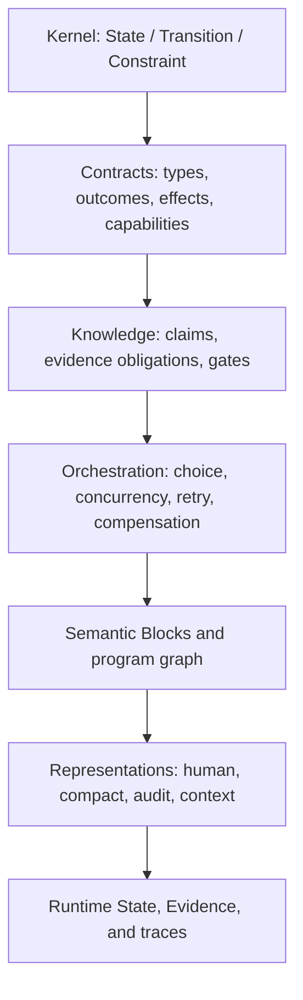

# Phase 0 Retrospective: Preserve Meaning, Remove Accidental Weight

- Status: Working review
- Scope: Foundations v0.1, RFC-0001 through RFC-0004, and current examples
- Purpose: Adversarial review before implementing a reference CLI

## Executive conclusion

The Phase 0 work has found a durable semantic spine:

```text
State
Transition
Constraint
```

It has also established several safety rules that should survive revision:

```text
Unknown is not false.
Authorization is not evidence.
Timeout is not failure.
Cancellation is not rollback.
Retry is not automatically safe.
Compensation is not an inverse.
Canonical bytes are not semantic truth.
```

However, RFC-0004 and its validation vector expose a design regression:

> We made the audit representation explicit, then accidentally treated its
> verbosity as the canonical AI representation.

The current order-fulfillment Canonical IR is deterministic and safety-minded,
but it is not yet evidence that the representation is AI-native. It repeats
schema information, empty fields, identity labels, and literal expression
wrappers at a rate that is likely hostile to retrieval and context budgets.

The correct response is not to remove safety semantics. It is to separate:

1. the semantic model;
2. a compact canonical wire encoding;
3. an expanded audit projection;
4. a purpose-bounded AI context projection;
5. runtime State, Evidence, and trace records.

Implementation of a general executor should pause. The next reference work
should test compact normalization, block identity, graph manifests, and semantic
neighborhood retrieval first.

The corresponding normative experiment is
[RFC-0005: Semantic Blocks, Layered IR, and Context Projections](./RFC-0005-semantic-blocks-and-context-projections.md).

## 1. What the previous work got right

### 1.1 The three-concept kernel remains plausible

No validation case has yet forced a fourth semantic-kernel primitive.

- Claims can be represented as State content.
- Evidence belongs to a verification layer.
- Execution policies remain Constraints.
- Composition remains graph structure over Transitions and Constraints.
- Retry, cancellation, and compensation remain derived graph patterns.

This is a success, but only a provisional one. The kernel has survived payment,
partial knowledge, concurrency, and compensation on paper. It has not yet
survived a compiler, verifier, cross-language lowering, or AI benchmark.

### 1.2 Transition as relation was the right choice

Treating a Transition as a typed relation rather than only a deterministic
function supports:

- several valid outcomes;
- environment choice;
- external observations;
- nondeterministic implementations;
- partial success;
- refinement into subgraphs.

This decision should remain.

### 1.3 Effects and authority must remain separate

RFC-0001 correctly separates:

```text
effect
  what may be observed or changed

capability
  what authority is required to attempt it
```

Removing this distinction would make the model smaller only by hiding a
security boundary.

### 1.4 RFC-0002 added a necessary epistemic boundary

The strongest conclusion from RFC-0002 is not the number of information values.
It is the separation of:

```text
claim
evidence
current information view
assurance profile
execution-gate decision
runtime observation
```

This prevents predicted, asserted, signed, verified, authorized, and observed
from collapsing into one misleading `true` flag.

### 1.5 RFC-0003 corrected common production errors

The following distinctions are essential and should remain normative:

- `FAILED` does not prove that no effect occurred;
- `CANCELLED` records an observed completion view, not merely a request;
- `INDETERMINATE` routes to reconciliation for effectful work;
- retry preserves intent identity and creates a new invocation identity;
- compensation establishes a new acceptable State;
- compensation order follows reverse causal dependency;
- parallel syntax does not prove independence.

### 1.6 RFC-0004 correctly limited content identity

The content digest is useful only because RFC-0004 refuses to call it a
universal hash of meaning.

The separation of:

```text
content_id
contract_id
implementation_id
invocation_id
equivalence claim + evidence
```

should remain.

## 2. Quantitative warning from the current validation vector

The present repository provides measurable evidence of representation growth.

| Artifact | Lines | Words | Bytes |
|---|---:|---:|---:|
| RFC-0001 | 763 | 2,952 | 20,755 |
| RFC-0002 | 1,180 | 4,311 | 31,602 |
| RFC-0003 | 1,433 | 5,412 | 39,667 |
| RFC-0004 | 1,516 | 6,002 | 45,522 |
| Human order projection | 475 | 729 | 9,609 |
| Pretty Canonical IR vector | 1,442 | 2,317 | 41,119 |
| JCS identity projection | — | — | 22,466 |

The pretty machine vector is `4.28x` the bytes of the human projection. Even
after removing annotations, whitespace, and object-member formatting, the JCS
identity bytes are `2.34x` the human projection.

This comparison is favorable to the machine vector: the human projection
covers the wider fulfillment workflow, while the JSON vector is mainly a
payment-reconciliation slice.

Compression reveals the cause:

| Artifact | Original bytes | gzip bytes | Compression ratio |
|---|---:|---:|---:|
| Human order projection | 9,609 | 2,317 | 0.241 |
| JCS identity projection | 22,466 | 2,718 | 0.121 |

The canonical identity projection contains:

- 95 empty arrays;
- 42 empty objects;
- 10 `null` values;
- 18 repeated typed `true` condition expressions;
- 59 occurrences of `node_id`;
- 54 occurrences of `port_id`;
- 51 occurrences of `expr`;
- 46 occurrences of `path`.

High compressibility is not itself a defect. Here it demonstrates that much of
the textual surface is repeated schema rather than unique semantic information.

These are byte and structural measurements, not model-token measurements. The
project still needs tokenizer- and model-specific experiments. It must not
claim an AI context advantage from bytes alone.

## 3. The central mistake: explicit semantics became explicit scaffolding

The original rule was:

> Important meaning should be represented once, explicitly, and
> machine-checkably.

RFC-0004 drifted toward:

> Every possible field, including schema-determined empty fields, should be
> repeated at every node.

Those are not equivalent.

The following omission is dangerous:

```text
action Charge
  effects omitted
```

because the reader cannot know whether the author forgot an effect.

The following omission can be safe:

```text
transform Add
```

when the exact `transform` form definition means its external effect footprint
is empty and the canonical expander reconstructs that fact deterministically.

The revised rule should be:

> Semantically variable safety information must be explicit. Schema-invariant
> empty or not-applicable fields may be omitted from the compact encoding when
> deterministic expansion restores exactly one audit representation.

This removes repetition without introducing executable guesses.

## 4. Concept collisions that need correction

### 4.1 “Unknown” currently names several different things

At least six concepts are presently expressed with similar words:

| Concept | Meaning | Recommended term |
|---|---|---|
| Optional domain field absent | Domain admits no value | `ABSENT` or optional absence |
| External domain outcome not established | Physical outcome unresolved | `outcome_unresolved` |
| Claim information has no eligible support either way | Epistemic state | `UNKNOWN` |
| Orchestrator cannot classify completion | Completion View | `INDETERMINATE` |
| Verifier exhausts knowledge or resources | Verification result | `INDETERMINATE` with verifier scope |
| Draft IR field lacks required meaning | Authoring state | `UNRESOLVED` |

`PaymentAttempt.status = unknown` is especially risky. It can be read as a real
domain status even though the intended meaning is that the physical charge
status has not been established.

A better representation separates:

```text
PaymentAttempt.observation = outcome_unresolved
information(charge_succeeded) = UNKNOWN
completion(CapturePayment) = INDETERMINATE
```

The project should not force all three into one enum value.

### 4.2 Semantic Block has two definitions

Foundations v0.1 initially describes a Block as a locally understandable,
independently verifiable semantic transition.

RFC-0001 later defines it as an interface-closed subgraph.

The second definition is stronger and should govern:

> A Semantic Block is an interface-closed semantic subgraph. A single
> Transition may be the smallest Block, but a Block is not limited to one
> Transition.

### 4.3 Hypergraph and directed graph remain unresolved

Foundations v0.1 favors a typed hypergraph. RFC-0004 serializes attributed nodes
and binary edges. Those need not conflict if a Transition becomes a node in a
typed bipartite graph, but the current vector does not prove this equivalence.

It mainly contains control and route edges. It does not fully encode the typed
data-flow topology between State/value ports and Transitions.

Therefore the current JSON vector validates outcome routing and identity, not a
final canonical topology.

### 4.4 Constraint is useful but overloaded

The project currently maps all of these to Constraint forms:

```text
state invariant
transition precondition
trace property
goal
assurance profile
execution policy
composition policy
```

This does not yet require a new primitive, but it does require a clear taxonomy.
Otherwise `Constraint` becomes a label meaning “everything that is not State or
Transition.”

Each form should declare:

- subject kind;
- temporal scope;
- evaluation domain;
- result algebra;
- enforcement boundary.

### 4.5 Static Evidence obligations and runtime Evidence are blurred

Actual Evidence records belong to runtime or verification bundles. Static IR
should contain:

- required claim shapes;
- assurance profiles;
- accepted methods;
- evidence obligations.

The current JSON vector contains opaque `evidence:*` strings without a schema or
import binding. They are useful placeholders, not a validated Evidence model.

## 5. Concrete inconsistencies and errata

### 5.1 RFC-0001 parallel independence condition

RFC-0001 currently states:

```text
writes(B) intersect reads(A) = empty
```

RFC-0003 correctly strengthens it to:

```text
writes(B) intersect (reads(A) union writes(A)) = empty
```

RFC-0003 should be treated as superseding that RFC-0001 line, and RFC-0001
should receive an erratum.

### 5.2 Three primitives versus four primitives

`ROADMAP.md` still says “Challenge the four-primitive hypothesis,” while the
current kernel is State / Transition / Constraint. This is stale wording.

### 5.3 Repository layout does not match the repository

`README.md` and `CONTRIBUTING.md` refer to `rfcs/`, `docs/`, `spec/`, and
`examples/` paths that do not match the current root-level files.

This creates broken links and false onboarding expectations.

### 5.4 Missing companion file

RFC-0003 and RFC-0004 link to `order-fulfillment.aicore`. The file is absent
from the current remote repository, so both links are broken.

### 5.5 RFC-0004 overcommits on numeric representation

Exact domain decimals such as money should not rely on host floating point.
That conclusion is sound.

The blanket prohibition of every JSON number inside `semantic` is not yet
justified. Bounded structural integers such as a retry count can be represented
interoperably under an exact profile. This choice should return to experiment
rather than remain a broad rule.

## 6. Keep, revise, and defer

### 6.1 Keep

- State / Transition / Constraint as the working kernel;
- Transition as a typed relation;
- explicit effect and capability boundaries;
- open-world evidence reasoning;
- `ALLOW | DENY | DEFER` execution gates;
- four Completion Views;
- explicit retry intent and invocation identity;
- causal compensation;
- observationally scoped equivalence;
- deterministic representation identity;
- strict handling of behavior-changing extensions;
- human syntax as a replaceable projection.

### 6.2 Revise

- define a precise unknown/outcome/completion vocabulary;
- define Block as an interface-closed subgraph;
- separate compact encoding from expanded audit view;
- replace repeated identity fields with maps keyed by stable identities where
  useful;
- omit only schema-invariant empties in compact form;
- add independently content-addressed Blocks plus a graph manifest;
- define semantic-neighborhood projection and completeness metadata;
- encode data-flow topology, not only orchestration routes;
- clarify Constraint forms;
- make Evidence obligation references typed and resolvable;
- benchmark actual AI token and task performance.

### 6.3 Defer

- a general executor;
- a stable public language standard;
- a final JSON Schema;
- per-node recursive Merkle links;
- a universal optimizer;
- a final constraint logic;
- a final binary codec;
- claims that the current IR is better for every AI model.

## 7. Revised layered architecture

The project should distinguish the following layers:



The layers do not add kernel primitives. They prevent the entire system from
being loaded or serialized as one undifferentiated object.

### 7.1 Canonical Semantic Model

The typed graph and its invariants. This is conceptual and implementation-
independent.

### 7.2 Compact Canonical Encoding

The unique identity-bearing wire form. It omits only information that an exact
schema reconstructs uniquely.

### 7.3 Expanded Audit Projection

A verbose, total view showing every applicable field, inferred schema invariant,
reference resolution, and diagnostic path.

RFC-0004's current JSON is closer to this view than to the ideal compact wire
form.

### 7.4 Semantic Context Projection

A purpose-bounded, evidence-bearing neighborhood for an AI or human task. It
must declare what was included, what lies across the boundary, and whether the
projection is complete for the requested purpose.

### 7.5 Runtime bundles

Concrete State, Claims, Evidence, invocation identity, completion observations,
and traces remain separate from the static program model.

## 8. Return to Block + Graph + Genome

The earlier biological and block-chain inspirations remain useful if applied
carefully.

### 8.1 Semantic Block

Each Block should have:

```text
stable block_id
block_content_id
interface contract
internal semantic graph
declared cross-boundary dependencies
annotations outside semantic identity
```

A local change should change that Block's content identity without forcing an
AI to reload unrelated Blocks.

### 8.2 Program Genome manifest

The program-level manifest should bind:

```text
program identity
block_id -> block_content_id
cross-block typed edges
entrypoints
exports
required vocabularies
```

The semantic graph may contain cycles because edges refer to stable Block
identities bound by the manifest. Content addressing does not require pretending
the semantic topology is acyclic.

### 8.3 Semantic neighborhood

For a task such as “modify payment reconciliation,” the retrieved neighborhood
should include:

- the target Block contract;
- directly affected State and type definitions;
- incoming and outgoing control/data routes;
- hard Constraints touching the target;
- effect and capability boundaries;
- Evidence and assurance obligations;
- compensation and retry dependencies;
- explicit cut-boundary references.

It should not automatically include every unrelated label, source map, or
workflow.

## 9. What must be measured next

The project cannot infer AI friendliness from design aesthetics.

For semantically equivalent cases, measure:

```text
representation bytes and actual model tokens
unique semantic facts per token
round-trip semantic diff
missing-dependency rate
invalid-transition proposal rate
constraint preservation after edit
diagnostic localization accuracy
retrieval completeness
human review time and error rate
cross-model consistency
```

The first cases should remain deliberately different:

1. calculator — pure deterministic relation;
2. payment — partial observation and irreversible effect;
3. fulfillment — concurrency, retry, and compensation;
4. AI research task — claims, tool evidence, and publication gate.

Each case should compare:

- conventional source plus documentation;
- human AI Native Core projection;
- compact canonical encoding;
- expanded audit projection;
- bounded semantic neighborhood.

## 10. External research that supports the correction

Parnas's module-decomposition work supports defining boundaries around hidden
decisions and comprehensibility rather than source-file convenience:

- D. L. Parnas,
  [On the Criteria to Be Used in Decomposing Systems into Modules](https://doi.org/10.1145/361598.361623),
  Communications of the ACM, 1972.

Program slicing supports computing a task-relevant dependency subset rather
than presenting an entire program indiscriminately:

- Mark Weiser,
  [Program Slicing](https://doi.org/10.1109/TSE.1984.5010248),
  IEEE Transactions on Software Engineering, 1984.

MLIR demonstrates the practical value of operating at several levels of
abstraction instead of forcing one representation to serve every lowering and
analysis purpose:

- Chris Lattner et al.,
  [MLIR: Scaling Compiler Infrastructure for Domain Specific Computation](https://doi.org/10.1109/CGO51591.2021.9370308),
  CGO 2021.

Repository-level code-generation research provides evidence that selective
retrieval of useful repository context can outperform using only the current
file or a naive retrieval pass:

- Fengji Zhang et al.,
  [RepoCoder: Repository-Level Code Completion Through Iterative Retrieval and Generation](https://arxiv.org/abs/2303.12570),
  EMNLP 2023.

These works motivate modular boundaries, dependency slices, layered IR, and
retrieval. They do not prove that the proposed AI Native Core representation is
optimal.

## 11. Decision before Phase 1 implementation

The project should make the following decision:

> Do not implement RFC-0004's verbose JSON shape as a stable public format.
> Treat it as an expanded audit prototype and content-identity test vector.

The next reference implementation should support only:

```text
parse a compact experimental projection
expand it deterministically
verify identity and structural invariants
extract a declared semantic neighborhood
report machine-readable incompleteness
```

Execution, code generation, and general optimization should wait until those
properties survive the four validation cases.

## 12. Current conclusion

The project has not failed by becoming detailed. The detail exposed which
information is truly necessary.

The correction is now to preserve that information with less accidental
surface area:

> Few primitives. Layered semantics. Simple Blocks. Rich topology. Compact
> transmission. Explicit verification.
