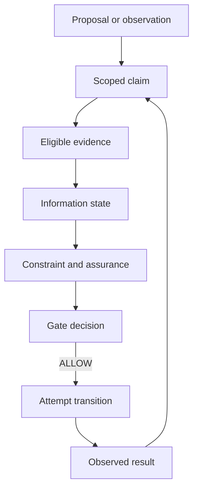

# RFC-0002: Knowledge, Evidence, and Execution Gates

- Status: Draft
- Version: 0.1
- Type: Foundational
- Depends on: RFC-0001
- Discussion target: Phase 0 knowledge and verification review

## Abstract

RFC-0001 requires incomplete, ambiguous, and conflicting meaning to remain
explicit. It also requires evidence-bearing verification before selected
semantic actions cross an execution boundary.

This RFC defines the minimum model needed to satisfy those requirements without
adding another semantic-kernel primitive.

The proposal separates four concepts:

```text
CLAIM
  what is asserted about a semantic subject

EVIDENCE
  what supports or refutes a claim

INFORMATION STATE
  what the currently admissible evidence says

EXECUTION POLICY
  whether that information and evidence are sufficient for an action
```

The central rule is:

> Evidence is not truth. Confidence is not verification. Verification is not
> authorization. Authorization is not evidence that an action succeeded.

Claims are State content. Evidence and provenance belong to the verification
layer. Execution policies are Constraints over claims, evidence, capabilities,
and proposed Transitions. The State / Transition / Constraint kernel therefore
remains unchanged.



The loop is intentional: permission to attempt a Transition is not evidence of
its outcome. A new observation must return through the Claim and Evidence model.

## 1. Decision proposed

Adopt the following Phase 0 knowledge model:

```text
KnowledgeView = evaluate(Claims, Evidence, Policy, Context)

Claim
  = a scoped proposition about an identified semantic subject

Evidence
  = an immutable record that supports or refutes a claim

InformationValue
  = UNKNOWN
  | SUPPORTED_TRUE
  | SUPPORTED_FALSE
  | CONFLICTING

Ambiguity
  = an explicit set of candidate semantic interpretations

GateDecision
  = ALLOW | DENY | DEFER
```

`VERIFIED` MUST NOT be stored as an absolute property of a claim. It is always a
derived statement of the form:

```text
verified(claim, policy, context, time)
```

Adoption means that implementations MUST preserve the distinction between raw
claims, evidence eligibility, information state, policy acceptance, capability
authorization, and runtime observation.

## 2. Scope

This RFC defines:

- the minimum structure of a Claim;
- positive and negative evidence support;
- explicit unknown and conflicting information;
- ambiguity as multiple candidate meanings;
- provenance and derivation requirements;
- evidence eligibility and invalidation;
- constraint evaluation under incomplete information;
- execution-gate decisions;
- propagation rules through semantic transitions;
- payment and AI-tool validation cases;
- minimum conformance and falsification criteria.

This RFC does not define:

- a universal epistemology or theory of truth;
- a universal numeric confidence scale;
- Bayesian inference or probabilistic planning semantics;
- a complete paraconsistent logic;
- a cryptographic signature format;
- a global identity or trust system;
- a human reputation system;
- a final provenance serialization;
- domain-independent rules for deciding which source is correct.

## 3. Relationship to the RFC-0001 kernel

RFC-0002 does not add Claim, Evidence, or Policy as kernel primitives.

They map to RFC-0001 as follows:

| RFC-0002 concept | RFC-0001 interpretation |
|---|---|
| Claim | Atomic or structured content in State |
| Claim update | A Transition that adds a claim or provenance relation |
| Information state | A derived State view over eligible evidence |
| Evidence | Verification-layer data bound to semantic identities |
| Provenance | A verification dependency graph |
| Execution policy | Constraints over State, Transition, capability, and evidence |
| Gate decision | Output of applying policy before an execution boundary |
| Ambiguity | Explicit candidate semantic States or subgraphs |

This layering is intentional. A program can describe hypothetical worlds
without possessing runtime evidence, and a verifier can reason about evidence
without turning evidence records into executable actions.

## 4. Normative language

The words MUST, MUST NOT, SHOULD, SHOULD NOT, and MAY describe requirements of
this proposal.

Examples use a provisional record notation. It is not the canonical IR format.

## 5. Claim model

A **Claim** is a scoped proposition about an identified semantic subject.

Minimum conceptual form:

```text
Claim
  claim_id
  subject_id
  predicate
  polarity
  scope
  valid_time
```

### 5.1 Subject

`subject_id` identifies what the claim is about. It SHOULD use an immutable
content, contract, implementation, event, resource-version, or transition
identity when available.

Examples:

```text
content:sha256:7fa291...
contract:payment/submit-charge/v2
attempt:pay_123
order:ord_456@version_8
```

A mutable display name alone is insufficient for evidence binding.

### 5.2 Predicate

The predicate expresses one proposition at a declared semantic scope.

Examples:

```text
PaymentAttempt.status == succeeded
Receipt.signature_valid == true
Implementation satisfies Contract#51ce02
Constraint AtMostOneCharge holds for Trace#98ab
```

Predicates MUST have deterministic canonical representations before they can be
content-addressed.

### 5.3 Polarity

Polarity records whether the claim asserts or denies the base proposition:

```text
ASSERT
DENY
```

Explicit denial is not the same as absence of an assertion.

The canonical representation SHOULD normalize simple negation into base
predicate plus polarity so evidence supporting `p` and evidence supporting
`not p` can be compared mechanically.

### 5.4 Scope and time

Claims MUST declare enough scope to prevent false conflicts.

Relevant dimensions MAY include:

```text
program version
resource version
execution or trace
environment
tenant or authority domain
valid time interval
observation time
```

The claims:

```text
Order.status == pending at t1
Order.status == paid at t2
```

do not conflict merely because their predicates differ. Their valid times and
the transition between them matter.

### 5.5 Claim identity

`claim_id` SHOULD be derived from the canonical claim content:

```text
claim_id = hash(
  subject_id,
  normalized predicate,
  polarity,
  scope,
  valid_time
)
```

Provenance, evidence, confidence, and verification status MUST NOT be included
in the claim identity. They describe support for the claim, not the proposition
itself.

## 6. Evidence model

**Evidence** is an immutable record offered in support of or opposition to a
claim.

Evidence does not make a claim true merely by existing.

Minimum conceptual form:

```text
Evidence
  evidence_id
  claim_id
  stance: SUPPORT | REFUTE
  subject_id
  kind
  artifact_ref
  artifact_digest
  producer
  method
  verifier
  assumptions
  environment
  observed_at
  valid_for
  dependencies
  signature_or_integrity
```

### 6.1 Subject binding

Evidence MUST bind to the exact semantic subject it concerns.

A test result for implementation `A` does not verify implementation `B` merely
because both have the same display name. A receipt for attempt `x` does not
verify attempt `y` merely because both belong to the same order.

If the subject changes, evidence MUST be re-evaluated for applicability.

### 6.2 Stance

Evidence has an explicit stance:

```text
SUPPORT
REFUTE
```

An artifact that only records provenance but makes no claim MAY use a neutral
provenance relation outside the support sets.

### 6.3 Kind and method

Evidence kind describes the broad form:

```text
assertion
observation
receipt
signature
test_result
model_check
proof
runtime_trace
external_attestation
```

Method describes how it was produced and checked. Implementations MUST NOT
infer assurance solely from a kind label.

Examples:

```text
kind: test_result
method: property_test(seed_set=..., cases=10000)

kind: receipt
method: gateway_signature_verification(keyset=v8)
```

### 6.4 Producer and verifier

The producer created the evidence. The verifier checked its structure,
integrity, method, or claim relationship.

They MAY be the same identity, but policy SHOULD distinguish self-assertion from
independent verification where that distinction matters.

### 6.5 Integrity is not truth

A valid signature can establish origin and integrity. It does not by itself
establish that the signed semantic claim is correct.

Likewise:

- a passing test establishes only the tested property under recorded inputs and
  environment;
- a proof establishes only its theorem under its formal assumptions;
- a runtime observation establishes only what the observation mechanism can
  soundly report;
- a model's confidence score establishes neither truth nor policy acceptance.

### 6.6 Evidence references

Sensitive or large evidence MAY remain outside the semantic IR. The evidence
record may contain a capability-protected reference plus an immutable digest.

The digest protects identity, not availability or authorization.

## 7. Provenance and derivation

Every derived claim MUST be explainable through a provenance graph.

The minimum relations are:

```text
wasDerivedFrom(derived_claim, source_claim_or_evidence)
wasGeneratedBy(evidence, activity)
wasAttributedTo(claim_or_evidence, agent)
used(activity, claim_or_evidence)
```

These names intentionally align with the W3C PROV family, but RFC-0002 does not
require a specific PROV serialization.

A derivation record SHOULD include:

```text
derivation rule or transition
input claim/evidence identities
tool or model identity and version
parameters relevant to reproducibility
output claim identities
assumptions
time
```

An AI-generated claim without a derivation record MAY remain a proposal. It MUST
NOT be silently promoted to an external observation.

### 7.1 Append-only history

Evidence history SHOULD be append-only.

Corrections, revocations, and later disagreement SHOULD add new records rather
than erase the fact that earlier evidence existed. Current policy views may
exclude invalid evidence while history retains it for audit.

### 7.2 Derivation invalidation

A derived claim must be re-evaluated when:

- a dependency subject changes;
- a required evidence record becomes ineligible;
- an assumption is refuted;
- the derivation method or verifier is revoked;
- the applicable policy changes;
- the claim's validity interval expires.

Invalidation changes applicability, not historical identity.

## 8. Evidence eligibility

Raw evidence is filtered through a named policy before it contributes to an
information state.

Conceptually:

```text
eligible(evidence, claim, policy, context, time) -> true | false | unknown
```

Eligibility MAY depend on:

- exact subject match;
- accepted producer or verifier identity;
- artifact integrity;
- accepted method and version;
- freshness or validity interval;
- environment match;
- assumption satisfaction;
- authority domain;
- dependency eligibility;
- revocation status.

An implementation MUST preserve diagnostics explaining why evidence was or was
not eligible.

Unknown eligibility MUST NOT be treated as eligible by default at an effectful
execution boundary.

## 9. Four-valued information state

For base proposition `p`, define eligible positive and negative support sets:

```text
E+(p) = eligible evidence supporting p
E-(p) = eligible evidence refuting p
```

After polarity normalization:

```text
E+(p) includes
  SUPPORT for ASSERT(p)
  REFUTE  for DENY(p)

E-(p) includes
  SUPPORT for DENY(p)
  REFUTE  for ASSERT(p)
```

This prevents a double-negation convention from changing the information value.

The information value is:

| `E+(p)` | `E-(p)` | Information value |
|---|---|---|
| empty | empty | `UNKNOWN` |
| non-empty | empty | `SUPPORTED_TRUE` |
| empty | non-empty | `SUPPORTED_FALSE` |
| non-empty | non-empty | `CONFLICTING` |

These are information states, not declarations of objective truth.

### 9.1 Open-world default

AI Native Core uses open-world reasoning by default:

```text
no evidence for p != evidence for not p
```

A closed-world rule MAY be declared for a bounded domain only when the semantic
contract defines what counts as complete enumeration and the required
completeness evidence is available.

### 9.2 Minimum connective behavior

Represent an information value as a pair `(t, f)` where each component records
eligible support for truth or falsity.

The minimum non-explosive operations are:

```text
not (t, f)
  = (f, t)

(t1, f1) and (t2, f2)
  = (t1 and t2, f1 or f2)

(t1, f1) or (t2, f2)
  = (t1 or t2, f1 and f2)
```

A conflict in one proposition MUST NOT imply arbitrary unrelated propositions.

Full implication, quantification, temporal operators, and domain-specific
reasoning rules are deferred. A guarded invariant:

```text
P => Q
```

is violated when `P` has admissible true support and `Q` has admissible false
support. Other cases may remain satisfied, unknown, or conflicting according to
the constraint profile; they MUST NOT be forced through classical explosion.

### 9.3 Unknown reason metadata

`UNKNOWN` remains one information value, but implementations SHOULD record a
reason when known:

```text
missing
unobserved
unavailable
withheld
indeterminate
not_yet_resolved
```

Reason metadata helps select the next valid Transition. It does not turn
unknown into a separate truth value.

## 10. Ambiguity

Ambiguity is not one of the four evidence-support values.

An **Ambiguity** contains multiple candidate semantic interpretations of the
same input:

```text
Ambiguity
  ambiguity_id
  source_ref
  candidates
  shared_claims
  distinguishing_questions
  resolution_policy
```

Example:

```text
source
  "Give premium users a small discount"

candidates
  A: premium = paid_plan; discount = 5%
  B: premium = loyalty_tier_gold; discount = 10%

shared_claim
  selected premium users receive a discount
```

The shared claim MAY be retained. Candidate-specific values MUST remain inside
their alternatives until resolved.

An AI MAY reason, compare, or plan across candidates. An effectful action whose
contract depends on unresolved candidate differences MUST be deferred unless an
explicit policy safely handles all candidates.

Probabilities MAY rank candidates for planning. They MUST NOT silently collapse
the candidate set into canonical meaning.

## 11. Assurance and verification

There is no universal scalar ordering in which every proof, test, signature,
receipt, observation, and human approval can be assigned one comparable
strength.

Instead, an **Assurance Profile** declares acceptable evidence predicates for a
specific claim and boundary.

Every profile MUST have an immutable identity or versioned content digest so a
verification result can name the exact requirements that were applied.

Example:

```text
assurance PaymentReceiptAcceptedV1

subject
  PaymentAttempt

requires
  receipt.attempt_id == PaymentAttempt.attempt_id
  receipt.amount == PaymentAttempt.amount
  receipt.gateway in approved_gateways
  receipt.signature.valid_under approved_keyset
  receipt not revoked

rejects
  conflicting eligible receipt or decline evidence
```

Verification is therefore:

```text
verified(claim, profile, context, time)
```

not:

```text
claim.verified = true forever
```

Human-readable labels such as `observed`, `checked`, or `proven` MAY summarize
the method, but the canonical record must retain the exact profile and evidence.

### 11.1 Model confidence

An AI model's probability, logit, self-reported confidence, or verbal certainty
MAY be recorded as evidence metadata.

It MUST NOT be treated as:

- a runtime observation;
- an independent verifier;
- a capability;
- a proof that a hard constraint holds.

A policy MAY permit probabilistic evidence for reversible, bounded-risk
operations. That permission must be explicit and effect-specific.

## 12. Execution gates

An execution gate evaluates a proposed action against current semantic state,
claims, evidence, constraints, capabilities, and policy.

Conceptually:

```text
gate(action, knowledge, capabilities, policy, context)
  -> decision
  + diagnostics
  + evidence_used
```

The minimum decisions are:

```text
ALLOW
DENY
DEFER
```

### 12.1 ALLOW

All required constraints, assurance conditions, and capability checks satisfy
the declared execution policy.

`ALLOW` means the action may be attempted. It does not claim that the action
will succeed.

### 12.2 DENY

The policy establishes a prohibiting condition, failed capability check, or
constraint violation.

### 12.3 DEFER

The policy cannot safely decide because required meaning, evidence,
capabilities, or conflict resolution is incomplete.

Diagnostics SHOULD state the next admissible resolution action, such as:

```text
request clarification
retrieve evidence
reconcile external state
obtain capability
invoke stronger verifier
escalate to named authority
```

### 12.4 Default boundary policy

Unless a more specific policy is declared:

- pure reasoning MAY continue under explicit unknown or ambiguity;
- reversible local transformations MAY use a bounded permissive policy;
- irreversible or externally effectful actions MUST defer on unknown required
  preconditions;
- conflicting required claims MUST defer or deny;
- missing capability MUST deny;
- a predicted outcome MUST NOT substitute for an observed outcome.

This default operationalizes:

> Reason under uncertainty. Execute only under verified semantics.

## 13. Constraint evaluation under partial knowledge

A verifier SHOULD return one of:

```text
SATISFIED
VIOLATED
UNKNOWN
CONFLICTING
```

The result MUST include:

```text
constraint_id
subject_id or trace_id
policy/profile
evidence used
missing evidence
conflicting evidence
assumptions
diagnostic path
```

The execution gate maps this richer result to `ALLOW`, `DENY`, or `DEFER`.
Different boundaries may map the same information state differently.

Example:

```text
constraint
  recommendation.title is known

pure draft policy
  UNKNOWN -> ALLOW placeholder branch

publish policy
  UNKNOWN -> DEFER
```

## 14. Propagation rules

### 14.1 No global unknown propagation

Unknown information propagates only through declared semantic dependencies.

If output `y` depends on unknown input `x`, `y` may be unknown. An independent
output `z` need not become unknown merely because both appear in the same
block.

Dependency edges are therefore required for precise local reasoning.

### 14.2 Pure derivation

A pure deterministic transform may produce a derived claim when:

- its required inputs are sufficiently supported;
- its implementation or semantic rule is accepted by policy;
- its derivation records all input claim and evidence identities.

The output evidence MUST reference the derivation rule and dependencies.

### 14.3 Effectful transition

Before execution, an action has candidate outcomes. After execution, only an
eligible observation can support an actual outcome.

```text
candidate outcome != observed outcome
```

An AI plan, simulator result, or implementation return prediction MUST NOT be
recorded as the external world's actual state.

### 14.4 Conflict propagation

Conflict propagates through a derivation only when the derivation depends on the
conflicting proposition in a way relevant to its result.

The system MUST preserve conflicting source evidence even if policy selects one
source for a particular view. Resolution is a policy decision with provenance,
not deletion of inconvenient evidence.

### 14.5 Ambiguity propagation

A transform applied to an ambiguity produces one result per viable candidate,
followed by safe merging of claims common to every candidate.

Candidate-specific results remain branched.

### 14.6 Evidence freshness

Evidence may cease to be eligible because of time, environment, subject, or
policy changes. Derived views must be recomputed without rewriting historical
records.

## 15. Validation case A: payment timeout

The payment case distinguishes request submission from known payment outcome.

### 15.1 Before submission

```text
claim
  PaymentAttempt.status == prepared

eligible support
  local durable record for exact attempt_id and amount

gate SubmitCharge
  capability payment.charge present
  idempotency constraints satisfied
  decision ALLOW
```

### 15.2 Request timeout

The client observes that a request was sent and that no conclusive response was
received.

Evidence may support:

```text
request_submitted == true
response_observed == false
```

It supports neither:

```text
charge_succeeded
charge_declined
```

Therefore:

```text
information(charge_succeeded) = UNKNOWN
PaymentAttempt.status = unknown
```

The system MUST NOT infer decline from the absence of a response.

### 15.3 Gate after timeout

```text
gate NewChargeAttempt
  decision DEFER
  reason unresolved prior attempt
  next action ReconcileCharge
```

An explicitly proven idempotent replay MAY be a different allowed transition.
It must reuse the bound intent and idempotency identity rather than invent a new
charge.

### 15.4 Signed success receipt

A later gateway observation supplies:

```text
receipt.attempt_id matches
receipt.amount matches
gateway identity accepted
signature integrity accepted
receipt not revoked
```

Under `PaymentReceiptAcceptedV1`, this evidence supports:

```text
PaymentAttempt.status == succeeded
```

`MarkPaid` may become `ALLOW` only after its remaining state, constraint, and
capability requirements also pass.

### 15.5 Conflicting observations

If eligible evidence supports both success and decline for the same attempt and
scope:

```text
information(charge_succeeded) = CONFLICTING
```

The default payment-write gate MUST `DEFER` or `DENY`. It MUST NOT use
last-write-wins unless a domain policy explicitly proves why ordering resolves
the conflict.

## 16. Validation case B: AI tool claims

An AI agent says:

```text
"The deployment configuration is valid."
```

This creates a proposed Claim, not verified fact.

Possible evidence graph:

```text
Claim ConfigurationValid
  ├── derived from ParseResult#12
  ├── derived from SchemaCheck#45
  ├── derived from PolicyCheck#83
  └── subject content:sha256:abc...
```

If the file changes to digest `def...`, the previous evidence does not verify
the new subject.

If schema checking passes but policy checking is unavailable:

```text
schema_valid = SUPPORTED_TRUE
policy_valid = UNKNOWN
configuration_valid = UNKNOWN
```

The AI may explain the partial result and request the missing check. A deploy
action whose policy requires both MUST return `DEFER`.

### 16.1 Tool output is scoped evidence

A successful tool invocation can establish that the tool returned a particular
output under recorded parameters. Whether that output establishes the target
claim depends on:

- tool identity and version;
- subject binding;
- method soundness;
- freshness;
- environment;
- execution policy.

The agent MUST NOT rewrite "tool returned X" into "X is universally true".

## 17. Validation case C: ambiguous human intent

Input:

```text
"Send the report to the project owner."
```

Available candidates:

```text
A: owner = repository owner
B: owner = project manager
C: owner = legal document owner
```

The agent may retrieve evidence for each candidate and retain shared intent:

```text
goal
  report is delivered to the intended project owner
```

Until the relevant owner role is resolved:

```text
gate SendMessage
  decision DEFER
```

A high model probability for candidate `B` is not sufficient evidence of human
intent unless the applicable communication policy explicitly accepts that risk.

## 18. Evidence interchange and prior standards

AI Native Core SHOULD interoperate with existing provenance and attestation
standards rather than inventing incompatible containers.

### 18.1 W3C PROV

W3C PROV defines domain-agnostic entities, activities, agents, and derivation
relations. RFC-0002 uses compatible conceptual relations for provenance graphs.

Primary source:

- [PROV-DM: The PROV Data Model](https://www.w3.org/TR/prov-dm/)

### 18.2 in-toto attestations

The in-toto Attestation Framework provides a general structure for verifiable
claims about how software artifacts are produced. A future AI Native Core
evidence codec SHOULD evaluate whether Claim subject binding and predicate data
can be carried in an in-toto statement.

Primary source:

- [in-toto Attestation Framework](https://github.com/in-toto/attestation)

### 18.3 SLSA provenance

SLSA demonstrates a useful distinction between the presence of provenance and
verification of that provenance against expectations. RFC-0002 applies the same
principle to semantic evidence: evidence must be inspected through policy.

Primary source:

- [SLSA Provenance](https://slsa.dev/spec/v1.2/)

### 18.4 Belnap–Dunn information values

The four support states in Section 9 are inspired by Belnap's treatment of
information from fallible and potentially inconsistent sources. RFC-0002 adds
provenance, evidence eligibility, ambiguity, and execution-gate semantics.

Research source:

- Nuel D. Belnap,
  [A Useful Four-Valued Logic](https://philpapers.org/rec/BELAUF-2).

## 19. Security considerations

The knowledge and evidence layer is security-critical.

Implementations must consider:

### 19.1 Evidence forgery

Attackers may fabricate receipts, test reports, signatures, tool outputs, or
provenance records. Integrity and producer authentication must be verified where
required by policy.

### 19.2 Subject substitution

Valid evidence for one artifact may be replayed against another. Exact subject
and scope binding is mandatory.

### 19.3 Stale evidence

Previously valid evidence may be reused after implementation, environment,
policy, keyset, or external state changes. Eligibility must include freshness
and dependency checks.

### 19.4 Evidence suppression

An attacker or biased agent may present supporting evidence while hiding
refuting evidence. Policies may require evidence-source completeness or
independent retrieval for high-impact claims.

### 19.5 Provenance spoofing

Human-readable producer names are not identities. Provenance links require
integrity-protected identifiers where trust decisions depend on them.

### 19.6 Assurance downgrade

An action must not silently switch to a weaker assurance profile when required
evidence is unavailable.

### 19.7 Prompt and tool injection

Untrusted content returned by a tool is evidence data, not trusted execution
policy. It must not redefine verifier rules, capabilities, or the semantic
meaning of unrelated instructions.

### 19.8 Time-of-check to time-of-use

Relevant subject, state, capability, and evidence identities SHOULD be bound to
the execution request. If they change after verification, the gate decision may
no longer apply.

## 20. Privacy and disclosure

Evidence may contain personal, commercial, operational, or security-sensitive
information.

The canonical semantic record SHOULD support:

- digest-bound external evidence;
- selective retrieval through capabilities;
- redacted human projections;
- minimal disclosure of irrelevant evidence fields;
- retention and deletion policies for raw artifacts;
- preservation of verification claims without exposing unnecessary payloads.

A digest does not anonymize predictable or low-entropy sensitive data.

## 21. Minimum conformance

An implementation claiming experimental RFC-0002 conformance MUST:

1. represent Claim separately from Evidence;
2. distinguish explicit denial from missing support;
3. compute `UNKNOWN`, `SUPPORTED_TRUE`, `SUPPORTED_FALSE`, and `CONFLICTING`
   from eligible support sets;
4. represent ambiguity as candidate meanings rather than a guessed value;
5. bind evidence to an immutable subject identity;
6. record evidence producer, method, scope, time, and dependencies;
7. preserve provenance for derived claims;
8. make verification relative to a named assurance policy;
9. produce `ALLOW`, `DENY`, or `DEFER` with machine-readable diagnostics;
10. prevent predicted outcomes from becoming external observations;
11. model payment timeout as unknown rather than decline or success;
12. invalidate or exclude stale evidence without deleting history;
13. contain conflicts without deriving unrelated claims;
14. treat missing capabilities independently from missing evidence.

## 22. Falsification criteria

This proposal is weakened or falsified if validation shows that:

1. positive and negative support cannot represent the minimum information needed
   for common conflicting-source cases;
2. ambiguity cannot be kept separate from evidence conflict without losing
   required behavior;
3. evidence eligibility requires an unbounded amount of hidden context;
4. policy-relative verification makes independent evidence exchange impossible;
5. provenance overhead prevents useful local semantic reasoning;
6. execution gates cannot be reproduced from recorded inputs and policy;
7. the model cannot distinguish prediction, attempted effect, and observed
   result in real integrations;
8. a concrete case requires a new semantic-kernel primitive rather than State,
   Transition, Constraint, or verification metadata.

A replacement RFC should include a counterexample and compare its human, AI,
storage, verification, and runtime costs with this model.

## 23. Open questions

1. Which exact logic profile should evaluate compound constraints under
   conflicting evidence?
2. Should evidence eligibility itself be four-valued?
3. How should quantifiers behave over incomplete collections?
4. What proves that a closed-world collection is complete?
5. Which provenance fields belong in canonical IR versus referenced evidence?
6. How should verifier and signing-key revocation propagate?
7. Can assurance profiles compose without accidentally weakening requirements?
8. How should human approval be scoped, expired, and revoked?
9. Which probabilistic evidence is acceptable for reversible low-risk actions?
10. How should evidence be cached across equivalent contracts and different
    implementations?
11. How should privacy-preserving or zero-knowledge evidence integrate?
12. Can an AI retrieve the minimum evidence neighborhood without omitting
    material refutation?

## 24. Consequences of adoption

If accepted for Phase 0:

- `VERIFIED` will be policy- and context-relative, not an absolute state;
- absence of evidence will not imply falsity by default;
- ambiguity will remain a candidate set until explicitly resolved;
- evidence will be immutable, subject-bound, and provenance-linked;
- AI confidence will remain separate from hard verification;
- every effectful execution gate will produce a reproducible decision and
  diagnostics;
- payment timeout and similar partial external outcomes will remain unknown
  until reconciled;
- the reference IR will need claim, evidence-reference, provenance, assurance,
  and gate-diagnostic records.

## 25. Current conclusion

The current working position is:

> Reliable AI-native execution requires more than a confidence score or a
> `verified` flag. It requires scoped claims, admissible evidence, explicit
> incomplete and conflicting information, reproducible policy evaluation, and a
> separate authorization check at the moment of action.
