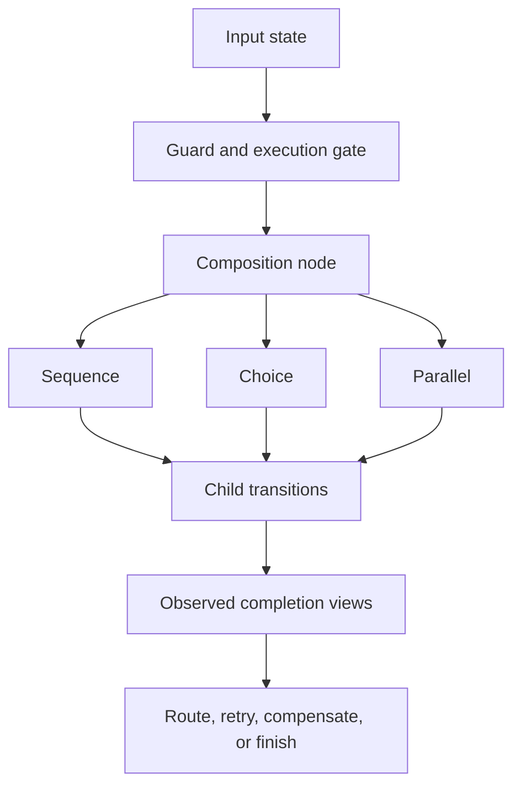

# RFC-0003: Composition, Concurrency, Failure, and Compensation

- Status: Draft
- Version: 0.1
- Type: Foundational
- Depends on: RFC-0001, RFC-0002
- Discussion target: Phase 0 composition and runtime-behavior review

## Abstract

RFC-0001 proposes State, Transition, and Constraint as the minimal semantic
kernel. It introduces provisional human operators:

```text
A >> B
A | B
A & B
when P -> A
```

Those symbols are readable but insufficiently precise for executable behavior.
For example, `A | B` does not say who chooses, `A & B` does not say how branches
join or interfere, and `A >> B` does not say what happens when `A` times out
after producing an external effect.

This RFC defines the minimum semantic contracts for sequence, choice, guard,
parallel composition, synchronization, failure, cancellation, retry, and
compensation.

The central rules are:

> Timeout is not failure. Cancellation is not rollback. Retry is not inherently
> safe. Compensation is not an inverse. Parallel syntax is not proof of
> independence.

Composition forms remain graph constructors over State, Transition, and
Constraint. They do not expand the semantic kernel.



## 1. Decision proposed

Adopt four human-facing composition forms:

```text
sequence
choice
guard
parallel
```

with the following requirements:

1. The canonical IR MUST represent them as annotated composition nodes, not as
   unqualified punctuation.
2. Every outgoing completion class MUST be routed or explicitly propagated.
3. Every choice MUST identify its selector and commitment point.
4. Every parallel composition MUST identify its join, cancellation, and
   interference policies.
5. Retry, timeout, cancellation, and compensation are derived semantic graph
   patterns, not new kernel primitives.
6. An external outcome is known only through evidence accepted under RFC-0002.
7. No composition-level policy may weaken a child Transition's constraints,
   capability requirements, or assurance profile without an explicit and
   verifiable policy override.

The concise surface symbols MAY remain:

```text
>>   sequence
|    annotated choice
&    annotated parallel composition
when guard
```

but bare `|` and `&` MUST NOT cross an executable boundary without canonical
selector, join, cancellation, and interference semantics.

## 2. Scope

This RFC defines:

- a common completion view for composition;
- sequence and outcome routing;
- external, policy, planner, and nondeterministic choice;
- guard behavior under partial knowledge;
- parallel start and join policies;
- data, effect, and semantic independence;
- synchronization through events and correlation identities;
- timeout, deadline, cancellation, and structured lifetimes;
- retry safety and idempotency requirements;
- compensation and Saga-style workflows;
- observational equivalence and conditional algebraic laws;
- trace and evidence requirements;
- adversarial fulfillment and AI-agent validation cases.

This RFC does not define:

- a scheduler;
- a thread or actor runtime;
- a network protocol;
- a lock implementation;
- a distributed consensus algorithm;
- a database transaction manager;
- a complete process calculus;
- real-time scheduling guarantees;
- a universal deadlock detector;
- a final surface syntax.

## 3. Relationship to the semantic kernel

The RFC-0001 kernel remains:

```text
STATE
TRANSITION
CONSTRAINT
```

Composition maps to it as follows:

| Composition concept | Kernel interpretation |
|---|---|
| Sequence | Relational composition plus outcome-routing constraints |
| Choice | Union of candidate transition relations plus a selector constraint |
| Guard | Restriction of a transition relation's admissible domain |
| Parallel | Product state plus permitted interleavings or synchronization constraints |
| Failure | A typed Transition completion and resulting State |
| Retry | A loop subgraph with attempt, identity, and safety constraints |
| Cancellation | A requested control Transition and observed child completions |
| Compensation | A separate effectful Transition related by a restoration claim |
| Saga | A forward dependency graph plus conditional compensation graph |
| Timeout | A timer observation competing with or constraining another trace |

These are useful named structures. They are not evidence that a fourth semantic
primitive is required.

## 4. Normative language

The words MUST, MUST NOT, SHOULD, SHOULD NOT, and MAY describe requirements of
this proposal.

Examples use provisional human notation. Their keywords and layout are
non-normative.

## 5. Invocation, trace, and completion view

Composition reasons over execution traces, not only final values.

A minimum step trace can contain:

```text
GateDecision
Invocation
EffectAttempt
Observation
CompletionView
```

Each record MUST identify its composition node, Transition, invocation, and
correlation scope.

### 5.1 Invocation identity

Every attempted Transition MUST have an immutable `invocation_id` distinct from
its Transition contract identity.

Repeated attempts of the same Transition therefore remain distinguishable:

```text
transition_id: SubmitCharge
invocation_id: charge_attempt_7
intent_id: order_42_charge
idempotency_key: order_42_charge_v1
```

### 5.2 Completion view

The orchestrating system observes one of four minimum completion views:

```text
SUCCEEDED(output)
FAILED(error)
CANCELLED(reason)
INDETERMINATE(observation_gap)
```

These are views supported by current evidence, not omniscient descriptions of
the external world.

`INDETERMINATE` means the orchestrator cannot establish success, failure, or
cancellation under the required RFC-0002 assurance profile.

### 5.3 Effects survive non-success

Every completion view carries or references the known effect trace:

```text
CompletionView
  class
  outputs
  known_effects
  unknown_effects
  evidence
```

`FAILED` does not imply no effect occurred. `CANCELLED` does not imply previous
effects were reverted. `INDETERMINATE` may mean an external effect occurred but
was not observed conclusively.

### 5.4 Completion is not contract success

A runtime returning normally does not by itself establish semantic success.
The output and postconditions must satisfy the declared assurance policy.

An implementation exception does not automatically establish semantic failure.
For an external call it may instead produce an indeterminate outcome.

## 6. Composition node contract

Every canonical composition node MUST declare:

```text
node_id
kind
children
input interface
output interface
completion routes
constraints
effect summary
capability delegation
assurance policy
lifetime scope
evidence obligations
```

Kind-specific fields are defined in later sections.

### 6.1 Child gates remain authoritative

A parent gate decision does not automatically authorize every child.

Before each effectful child invocation, current State, Evidence, Constraints,
and delegated capabilities MUST still satisfy the child's execution policy.

### 6.2 Capability delegation

A composition scope SHOULD delegate the minimum capability subset required by
each child.

Children MUST NOT inherit unrelated ambient authority from the parent runtime.

### 6.3 Outcome coverage

For each child, every possible completion class MUST be:

- routed to another node;
- returned as a composition result;
- converted through an explicitly named policy; or
- declared unreachable with verification evidence.

An omitted failure, cancellation, or indeterminate route is invalid. It is not
an implicit success route.

## 7. Sequence

Human form:

```text
A >> B
```

Sequence means that an eligible completion of `A` enables an invocation of `B`.

Default behavior:

```text
A.SUCCEEDED(output matching B.input)
  -> evaluate B guard and gate
  -> invoke B if ALLOW

A.FAILED
  -> propagate FAILED

A.CANCELLED
  -> propagate CANCELLED

A.INDETERMINATE
  -> propagate INDETERMINATE
```

The default MUST NOT invoke `B` after a non-success view.

### 7.1 Explicit routing

Non-default behavior uses named routes:

```text
sequence A then
  on success -> B
  on failure RetryableError -> RetryA
  on failure PermanentError -> RecordFailure
  on cancelled -> CancelScope
  on indeterminate -> ReconcileA
```

Routes are selected from typed Completion Views. They are not untyped exception
labels.

### 7.2 Interface compatibility

For every routed output from `A` to `B`:

- the output type MUST satisfy `B`'s input type;
- required State claims MUST be available;
- `B`'s preconditions MUST be evaluated under RFC-0002;
- required capabilities MUST be present at the child gate.

### 7.3 Partial success

A child producing several outputs may successfully establish some claims while
leaving others unknown. Sequence routing MUST name the actual contract condition
that enables `B`; the label `SUCCEEDED` alone may be insufficient.

### 7.4 Sequence associativity

Sequence is associative only under a declared observation boundary and
compatible routing:

```text
(A >> B) >> C  ~=  A >> (B >> C)
```

This law requires that regrouping does not change:

- child invocation order;
- completion routing;
- cancellation scope;
- effect trace visible at the boundary;
- capability delegation;
- evidence requirements.

## 8. Choice

Human form:

```text
A | B
```

Choice denotes multiple candidate branches. Executable choice MUST declare who
or what selects a branch.

### 8.1 Selector kinds

Minimum selector kinds are:

```text
environment
policy
planner
executor
nondeterministic specification
```

#### Environment choice

The environment commits the choice by producing an accepted event or outcome.

Example:

```text
choice selector environment
  when Payment.succeeded -> MarkPaid
  when Payment.declined  -> RecordDecline
```

#### Policy choice

A deterministic named policy selects a branch from current State and Evidence.
The policy identity and selection evidence MUST be recorded.

#### Planner choice

An AI or other planner proposes a branch. Its selection remains subject to all
branch gates and constraints. Planner choice does not grant capability.

#### Executor choice

The runtime selects a branch according to a declared operational policy such as
load, locality, or availability. Selection criteria relevant to semantics MUST
be recorded.

#### Nondeterministic specification choice

The specification permits any listed branch. Before concrete execution, an
implementation MUST refine the choice into an executable selector or prove that
all possible choices satisfy the required contract.

### 8.2 Commitment point

Choice MUST declare when alternatives cease to be viable:

```text
before_start
on_guard_resolution
on_event
on_first_completion
on_first_success
```

The last two commitment modes imply concurrent branch execution and are race
patterns, not ordinary pre-start choice.

### 8.3 Choice coverage

For guarded branches, policy SHOULD check:

- overlap: more than one branch may match;
- gap: no branch may match;
- unknown: required guard evidence is incomplete;
- conflict: branch guards receive contradictory support.

The selector policy must define behavior for each permitted case.

### 8.4 Race choice

A race is parallel execution followed by a commitment rule.

It MUST declare:

```text
winner condition
loser cancellation policy
late-result policy
effect-conflict policy
evidence required to commit
```

Race between irreversible effectful actions is invalid unless the contract
explicitly permits multiple effects or provides proven reconciliation and
compensation.

## 9. Guard

Human form:

```text
when P -> A
```

Guard restricts the admissible input domain of `A`.

The RFC-0002 constraint result maps by policy:

| Guard result | Default behavior |
|---|---|
| `SATISFIED` | Evaluate the gate for `A` |
| `VIOLATED` | Disable this branch |
| `UNKNOWN` | `DEFER` |
| `CONFLICTING` | `DEFER` |

A low-risk profile MAY define different behavior, but the mapping must be
explicit and evidence-bearing.

### 9.1 Guard evaluation time

The canonical node MUST state when the guard is checked:

```text
at composition entry
immediately before child invocation
continuously until commitment
```

For effectful actions, the default is immediately before invocation to reduce
time-of-check to time-of-use drift.

### 9.2 No implicit else

A false or unresolved guard does not imply another branch. Fallback behavior
must be declared through choice coverage or an explicit route.

## 10. Parallel composition

Human form:

```text
A & B
```

Parallel composition allows child traces to overlap. It MUST declare start,
join, cancellation, and interference semantics.

### 10.1 Start policy

Minimum start policies:

```text
all_when_ready
bounded_parallelism(k)
dependency_ready
```

`all_when_ready` does not promise simultaneous physical execution. It means no
semantic ordering is imposed after child gates allow invocation.

### 10.2 Join policy

Minimum join policies:

```text
all_success
wait_all
first_success
first_completion
quorum(k)
```

Each join policy MUST define:

- the composition completion condition;
- treatment of failed, cancelled, and indeterminate children;
- whether unfinished children are cancelled, awaited, or detached;
- whether late observations can revise the parent State;
- how outputs and evidence are merged.

### 10.3 Structured lifetime default

By default, child scopes MUST NOT outlive their parent composition scope.

The parent reaches a terminal completion only after every child is terminal or
has been transferred to an explicitly declared detached scope with its own
owner, capabilities, and evidence obligations.

### 10.4 Data independence

For child `A`, let:

```text
R(A) = declared read footprint
W(A) = declared write footprint
```

A sufficient initial data-independence check for `A` and `B` is:

```text
W(A) intersect (R(B) union W(B)) = empty
W(B) intersect (R(A) union W(A)) = empty
```

This is sufficient only at the declared resource granularity. Incomplete
footprints invalidate the conclusion.

### 10.5 Effect independence

External effects require more than read/write-set separation.

The parallel node MUST establish one of:

```text
effects are disjoint
effects commute under a named contract
effects synchronize through a declared protocol
shared resource provides an accepted consistency guarantee
all interleavings satisfy the required constraints
```

### 10.6 Semantic independence

Data and effect independence are not sufficient when branches are coupled by a
business invariant.

Example:

```text
ReserveInventory writes Inventory
ChargePayment writes PaymentGateway
```

Their resource footprints may be disjoint, but the program constraint:

```text
charged => inventory reserved | refund obligated
```

couples their outcomes. The parallel composition must represent the resulting
obligation and failure routes.

### 10.7 Shared concurrent objects

When children operate on a shared concurrent object, the composition MUST name
the accepted correctness profile, such as:

```text
serialized
linearizable
commutative
transactionally isolated(level)
explicitly nondeterministic within constraints
```

The label requires evidence from the resource implementation or integration. It
is not inferred from syntax.

### 10.8 Deadlock and livelock

Parallel composition SHOULD expose synchronization dependencies so a verifier
can search for:

- circular wait;
- unreachable join conditions;
- repeated transitions without progress;
- starvation under declared fairness assumptions.

Absence of a detected deadlock is not proof of liveness unless the verifier and
bounded model justify that claim.

## 11. Synchronization and asynchronous events

Synchronization is expressed through correlated State and event Transitions.

Example:

```text
WaitingForPayment
  + PaymentWebhook(attempt_id)
  -> PaymentObserved
```

### 11.1 Correlation identity

Every asynchronous response MUST bind to the initiating intent or invocation
through an immutable correlation identity.

Display names, temporal proximity, or matching amounts alone are insufficient.

### 11.2 Await is derived

`await Event` is a human convenience for:

- a waiting State;
- one or more event-driven Transitions;
- cancellation and deadline Transitions;
- correlation and evidence constraints.

It is not a new kernel primitive.

### 11.3 Timeout

A timeout means a timer event was observed before the required completion
evidence.

It does not prove that the underlying operation failed or stopped.

Default route:

```text
timeout after external effect attempt
  -> INDETERMINATE
  -> reconcile or await authoritative observation
```

### 11.4 Deadline

A deadline is a trace Constraint on when an action may start, commit, or remain
useful. Reaching a deadline may trigger cancellation or fallback, but those are
separate Transitions with their own outcomes.

### 11.5 Late observations

The composition MUST define how observations arriving after timeout,
cancellation request, race commitment, or parent completion update State and
obligations.

Ignoring a late external success is not equivalent to the effect not occurring.

## 12. Failure

Failure is a typed semantic outcome, not an unstructured escape from the graph.

### 12.1 Failure taxonomy

Transitions SHOULD distinguish at least:

```text
domain rejection
precondition violation
authorization denial
transient infrastructure failure
permanent infrastructure failure
constraint violation
invalid output
```

`INDETERMINATE` is not a failure class. It is insufficient knowledge of the
underlying completion.

### 12.2 Failure effects

A failure record MUST include known and unknown effects. A child that failed
after writing state cannot be treated like a child that never started.

### 12.3 Failure containment

A child failure affects only dependent outputs and constraints unless the
composition policy explicitly fails the whole scope.

Fail-fast is one policy, not a universal law.

### 12.4 Error identity

Machine routing SHOULD use stable typed error identities and fields. Human
messages are projections and MUST NOT be the sole semantic discriminator.

## 13. Retry

Retry is a loop subgraph that creates another invocation of a Transition.

It MUST declare:

```text
retryable completion classes
maximum attempts or budget
deadline
backoff policy
intent identity
attempt identity rule
idempotency strategy
indeterminate-outcome policy
capability and evidence recheck
terminal route
```

### 13.1 Retry safety

Retry is permitted only when at least one is established:

```text
the Transition is pure
the effect is idempotent for the stable intent identity
duplicates are prevented by an external contract
duplicates are semantically acceptable under constraints
reconciliation proves the prior attempt had no effect
```

### 13.2 Indeterminate outcomes

An indeterminate effectful attempt MUST NOT be retried as a new intent by
default.

The next valid action is normally:

```text
reconcile prior attempt
or replay exact idempotent intent under proven provider semantics
```

### 13.3 Stable intent, distinct attempts

Retries preserve the semantic intent identity while generating distinct
invocation identities.

This allows evidence to answer both:

```text
How many attempts occurred?
Did they represent one logical effect or several?
```

### 13.4 Backoff is not semantics-free

Backoff, jitter, and deadlines may affect fairness, rate limits, cost, and
externally visible behavior. Values material to constraints MUST be represented
in the retry policy rather than hidden in an implementation library.

## 14. Cancellation and lifetime

Cancellation is a request to stop work that is no longer required.

It is normally cooperative:

```text
CancelRequested
  -> child observes request
  -> child reaches CANCELLED, FAILED, SUCCEEDED, or INDETERMINATE
```

### 14.1 Cancellation is not rollback

Cancellation does not erase completed effects. Any required restoration is a
separate compensation graph.

### 14.2 Cancellation propagation

A composition scope MUST declare:

```text
parent-to-child propagation
child-failure-to-sibling propagation
deadline propagation
loser cancellation for race or quorum
```

### 14.3 Detached work

Detached work MUST declare a new lifetime owner, capability set, observation
channel, and failure/indeterminate handling policy.

Fire-and-forget is not an acceptable semantic contract for an effectful action
whose result can create obligations.

### 14.4 Cancellation evidence

Evidence that a cancellation request was sent is not evidence that the child
stopped before producing an effect.

## 15. Compensation

A compensation is an ordinary effectful Transition related to an earlier
Transition by a scoped restoration claim.

```text
compensates(C, A, restoration_contract)
```

### 15.1 Compensation is not an inverse

In general:

```text
C >> A != stay
A >> C != stay
```

Examples:

- a refund does not erase payment-processing fees or audit records;
- a cancellation email does not make the original email unread;
- releasing inventory may not restore the same market availability;
- deleting a created resource may not erase external references.

Compensation restores named Constraints or establishes a new acceptable State.
It does not recreate history.

### 15.2 Compensation contract

Every compensation relation MUST declare:

```text
forward Transition and invocation scope
trigger conditions
required evidence that the forward effect occurred
restoration postconditions
effects and capabilities
its own success, failure, cancellation, and indeterminate routes
retry or escalation policy
```

### 15.3 Unknown forward outcome

If the forward action is indeterminate, compensation MUST normally wait for
reconciliation.

A compensation MAY run under uncertainty only if policy proves it is safe when
the forward effect did not occur, for example through an idempotent conditional
provider operation.

### 15.4 Compensation failure

Compensation can fail or become indeterminate. The graph MUST represent:

```text
compensation_pending
compensation_running
compensated
compensation_failed
compensation_indeterminate
manual_resolution_required
```

Declaring a compensation does not guarantee restoration.

## 16. Saga-style workflows

A Saga is a forward dependency graph paired with conditional compensations.

Sequential example:

```text
A1 >> A2 >> A3

compensations
  C1 compensates A1
  C2 compensates A2
  C3 compensates A3
```

If `A3` fails after `A1` and `A2` succeed, a typical compensation trace is:

```text
C2 >> C1
```

`C3` does not run unless evidence shows `A3` produced the effect it compensates.

### 16.1 Causal reversal

Compensation order follows the reverse of the forward causal dependency graph,
not blindly the reverse of wall-clock completion time.

Independent forward branches MAY have independent compensations. Coupled
compensations require explicit ordering or synchronization.

### 16.2 Saga acceptance condition

A Saga terminal State MUST distinguish:

```text
completed
compensated
partially_compensated
indeterminate
manual_resolution_required
```

`compensated` is a successful domain outcome only relative to declared
restoration Constraints.

### 16.3 Isolation is not implied

Saga steps may be visible and interleaved with other workflows. The program must
account for concurrent observations and actions against intermediate states.

## 17. Runtime atomicity and semantic transactions

AI Native Core uses **Semantic Transaction** for a verifiable transformation of
the program semantic graph.

This is different from a runtime database or distributed transaction.

```text
semantic transaction
  changes program meaning

runtime atomic transaction
  changes runtime resources under an atomicity/isolation contract
```

If a runtime provides atomic commit or rollback, the composition may use an
`atomic_group` profile backed by capability, implementation, and verification
evidence.

The presence of a group in the semantic graph MUST NOT invent runtime atomicity.

## 18. Observational equivalence

Composition laws are relative to an observation boundary.

Let:

```text
Obs(trace, boundary)
```

project a trace to the events, State changes, effects, timing distinctions, and
evidence visible at that boundary.

Two compositions are observationally equivalent when every accepted trace of
one has a matching accepted projected trace of the other under the declared
equivalence relation.

### 18.1 Identity

A pure `stay` Transition may act as a sequence identity when it adds no visible
State, effect, timing, capability, or evidence difference:

```text
stay >> A ~= A
A >> stay ~= A
```

### 18.2 Choice laws

Choice may be associative or commutative only when selector semantics, branch
priority, commitment, diagnostics, and effects are symmetric.

Planner priority choice is not generally commutative.

### 18.3 Parallel laws

Parallel may be commutative only when:

- children are semantically independent or correctly synchronized;
- join and cancellation policies are symmetric;
- output merge is symmetric;
- observation boundary ignores physical scheduling order.

### 18.4 Distributivity

Distributive laws such as:

```text
A >> (B | C)  ~=  (A >> B) | (A >> C)
```

do not hold generally for effectful `A`, because the right side may duplicate
`A`, alter its commitment point, or change evidence and capability use.

No optimizer may apply an algebraic rewrite without verifying its side
conditions at the chosen observation boundary.

## 19. Verification and evidence

Every composition execution SHOULD produce evidence sufficient to reconstruct:

```text
composition node and version
selected branch and selector
guard results
child gate decisions
invocation and correlation identities
start and completion observations
known and unknown effects
join decision
cancellation requests and observations
retry intent and attempt identities
compensation triggers and results
constraints and assurance profiles used
```

### 19.1 Parent summaries

A parent completion claim is derived from child claims under the exact
composition policy. It MUST retain provenance to child evidence.

### 19.2 Reproducibility

Given the same recorded State, eligible Evidence, capabilities, composition
policy, and observation trace, a deterministic gate and routing policy SHOULD
produce the same semantic decision.

Physical scheduling need not be reproducible. Its semantically material events
must be recorded.

### 19.3 Late evidence

Late evidence may revise an `INDETERMINATE` view and create new obligations. The
system MUST preserve the earlier decision context rather than rewriting history
as though the outcome had always been known.

## 20. Canonical IR requirements

The future canonical IR SHOULD represent composition nodes approximately as:

```text
CompositionNode
  node_id
  kind
  children
  routes
  selector
  commitment
  start_policy
  join_policy
  cancellation_policy
  synchronization
  retry_policy
  compensation_edges
  constraints
  capability_delegation
  assurance_profile
  lifetime_scope
  observation_boundary
```

Fields not applicable to a kind may be explicitly empty. Fields required by a
kind MUST NOT be inferred from runtime defaults.

### 20.1 Topology over nesting

Human syntax may nest operators. Canonical semantics SHOULD normalize them into
an attributed graph with stable node and edge identities so dependencies,
compensations, and evidence remain addressable.

### 20.2 Derived patterns

The IR MAY preserve named patterns such as `retry`, `race`, and `saga` for human
review while also exposing their expanded State / Transition / Constraint graph
for verification.

## 21. Validation case A: order fulfillment

The validation workflow combines safe parallel reads, effectful sequence,
failure, indeterminate payment, and compensation.

The companion human projection is
[`order-fulfillment.aicore`](./order-fulfillment.aicore). It is design input for
the future canonical IR, not an executable syntax commitment.

### 21.1 Pure and read-only parallel stage

```text
ValidateOrder
  >> parallel PricingInputs
       children
         CalculateTax
         FetchShippingQuote
       start all_when_ready
       join all_success
```

This stage is parallelizable only if declared reads and any external quote
effects meet the required independence and freshness constraints.

### 21.2 Effectful forward workflow

```text
ReserveInventory
  >> CapturePayment
  >> CreateShipment
  >> ConfirmOrder
```

Compensations:

```text
ReleaseInventory compensates ReserveInventory
RefundPayment   compensates CapturePayment
CancelShipment  compensates CreateShipment
```

### 21.3 Shipment failure

If shipment creation is known to have failed after reservation and payment are
known to have succeeded:

```text
RefundPayment >> ReleaseInventory
```

The terminal State is `compensated` only when the declared refund and inventory
restoration Constraints are satisfied.

### 21.4 Indeterminate payment

If capture timed out:

```text
CapturePayment = INDETERMINATE
```

The system MUST NOT:

- create shipment as if payment succeeded;
- start a new payment intent as if payment failed;
- refund as if payment definitely succeeded.

The required route is reconciliation or an explicitly safe conditional
operation.

### 21.5 Concurrent reserve and payment variant

Running reservation and capture concurrently may reduce latency, but disjoint
resource footprints do not remove the business coupling.

The parallel version must prove or handle every combination:

| Inventory | Payment | Required route |
|---|---|---|
| succeeded | succeeded | continue |
| succeeded | failed | release inventory |
| failed | succeeded | refund payment |
| failed | failed | finish failed |
| any | indeterminate | reconcile before dependent action |

This matrix is required semantic topology, not an implementation detail.

## 22. Validation case B: AI-agent research

An AI agent may query several independent read-only sources in parallel:

```text
parallel GatherEvidence
  children
    SearchPrimaryDocs
    QueryRepository
    RunLocalCheck
  join wait_all
```

If policy uses `first_sufficient_evidence`, it is a quorum or race profile and
must define:

- what counts as sufficient;
- whether remaining tools are cancelled;
- how late conflicting evidence is handled;
- whether tool calls have cost or side effects;
- which claims each result actually supports.

A later effectful action such as publishing, sending, or modifying code remains
sequentially gated by the combined evidence. Parallel research does not grant
permission to act.

## 23. Related formal foundations

AI Native Core should reuse established concurrency and transaction theory.

### 23.1 Communicating Sequential Processes

CSP distinguishes sequential composition, external and internal choice,
parallel composition, synchronization, timeout, and interruption. RFC-0003
adopts the lesson that these are semantically distinct even when a surface
language wants few symbols.

Primary source:

- C. A. R. Hoare,
  [Communicating Sequential Processes](https://doi.org/10.1145/359576.359585),
  Communications of the ACM, 1978.

### 23.2 Petri nets

Petri nets remain a candidate topology for concurrent enablement,
synchronization, reachability, and deadlock analysis. RFC-0003 does not assume
that every domain uses token semantics.

Primary source:

- Tadao Murata,
  [Petri Nets: Properties, Analysis and Applications](https://doi.org/10.1109/5.24143),
  Proceedings of the IEEE, 1989.

### 23.3 Bernstein independence conditions

The read/write checks in Section 10 derive from Bernstein's conditions for
parallel processing. RFC-0003 treats them as a useful sufficient test at a
declared resource granularity, not a complete proof of semantic independence.

Primary source:

- A. J. Bernstein,
  [Analysis of Programs for Parallel Processing](https://doi.org/10.1109/PGEC.1966.264565),
  IEEE Transactions on Electronic Computers, 1966.

### 23.4 Linearizability

When parallel children share a concurrent object, linearizability is one
possible correctness contract: each operation appears to take effect at a point
between invocation and response while preserving real-time order constraints.

Primary source:

- Maurice P. Herlihy and Jeannette M. Wing,
  [Linearizability: A Correctness Condition for Concurrent Objects](https://doi.org/10.1145/78969.78972),
  ACM TOPLAS, 1990.

### 23.5 Sagas

Saga research provides the foundation for decomposing long-lived transactions
into steps with compensating transactions. RFC-0003 emphasizes that
compensation establishes a new acceptable State rather than erasing history.

Primary source:

- Hector Garcia-Molina and Kenneth Salem,
  [Sagas](https://doi.org/10.1145/38713.38742),
  ACM SIGMOD, 1987.

### 23.6 Structured concurrency

Structured-concurrency designs motivate bounded child lifetimes and explicit
cancellation propagation. RFC-0003 keeps these as the default semantic lifetime
policy without requiring a specific language runtime.

Reference design:

- Swift Evolution,
  [Structured Concurrency](https://github.com/swiftlang/swift-evolution/blob/main/proposals/0304-structured-concurrency.md).

## 24. Security considerations

### 24.1 Duplicate effects

Unsafe retry or race may duplicate charges, messages, resource creation, or
other effects. Stable intent identity and provider guarantees must be verified.

### 24.2 Capability amplification

Parallel or retry composition may multiply invocations. Capability policies
must limit count, scope, resource, and budget where relevant.

### 24.3 Cancellation confusion

An attacker or faulty runtime may report that cancellation was requested while
the effectful child continues. Only observed completion evidence can close the
obligation.

### 24.4 Late-result attacks

Delayed or replayed events may arrive after timeout or compensation. Correlation
identity, freshness, replay protection, and current State constraints are
required.

### 24.5 Compensation abuse

Compensation capabilities such as refund, deletion, release, or revocation may
be powerful independently. They require their own authorization and evidence;
they are not automatically granted with the forward capability.

### 24.6 Resource exhaustion

Unbounded parallelism, retry, evidence gathering, or compensation loops can
consume resources indefinitely. Composition policies must support explicit
budgets and deadlines.

### 24.7 Selector manipulation

Untrusted content must not redefine choice priority, join criteria, retry
safety, or compensation routing. These belong to authenticated semantic policy.

## 25. Minimum conformance

An implementation claiming experimental RFC-0003 conformance MUST:

1. represent sequence completion routing;
2. distinguish success, failure, cancellation, and indeterminate completion
   views;
3. identify every invocation separately from Transition identity;
4. declare the selector and commitment point for executable choice;
5. declare start, join, cancellation, and interference policies for parallel
   composition;
6. preserve child constraints, capabilities, and assurance gates;
7. represent timeout as an observation, not automatic failure;
8. prohibit unsafe retry after an indeterminate effectful attempt;
9. preserve stable intent identity across retries and distinct invocation
   identities per attempt;
10. represent cancellation as a request plus observed completion;
11. represent compensation as an independent effectful Transition;
12. record restoration postconditions and compensation failure routes;
13. order compensation by causal dependencies;
14. distinguish Semantic Transactions from runtime atomic transactions;
15. produce trace evidence for selection, child gates, effects, join, retry,
   cancellation, and compensation;
16. model every row of the concurrent inventory/payment outcome matrix in
   Section 21.5.

## 26. Falsification criteria

This proposal is weakened or falsified if:

1. a common composition behavior cannot be represented without adding a new
   semantic-kernel primitive;
2. explicit selector and join policies make ordinary composition unusably
   verbose without improving verification;
3. the Completion View cannot distinguish real production failure cases;
4. dependency and effect footprints cannot support useful static concurrency
   checks;
5. expanded retry and compensation graphs cannot be canonicalized
   deterministically;
6. observational equivalence cannot support safe regrouping or optimization in
   any useful restricted profile;
7. real runtimes cannot emit the minimum trace evidence without prohibitive
   overhead;
8. the model cannot prevent duplicate payment effects under timeout and retry;
9. the model cannot express partial compensation and manual resolution without
   invented success semantics.

Any replacement should include concrete counterexamples and compare ambiguity,
human review cost, AI context cost, verification power, and runtime overhead.

## 27. Open questions

1. Should the canonical model use interleaving traces, event structures, Petri
   nets, or multiple equivalent projections for concurrency?
2. Which fairness assumptions are safe to expose in the minimal IR?
3. What is the minimum synchronization vocabulary?
4. How should stream processing and unbounded child lifetimes fit structured
   scopes?
5. Which consistency profiles beyond linearizability should be standard?
6. Can effect commutativity be inferred or must it always be declared and
   proven?
7. How should race winners be revised when late evidence refutes the apparent
   completion?
8. Can compensation graphs be synthesized safely from restoration Constraints?
9. How should human approval interact with cancellation and compensation?
10. Which algebraic rewrites remain valid under evidence and capability
    observation boundaries?
11. What bounded model-checking profile is sufficient for the first reference
    verifier?
12. How should distributed clock uncertainty affect deadline and ordering
    claims?

## 28. Consequences of adoption

If accepted for Phase 0:

- `>>`, `|`, `&`, and `when` remain readable projections, not complete
  canonical semantics;
- executable choice will always name its selector and commitment point;
- executable parallel composition will always name join, cancellation, and
  interference policies;
- timeout will produce indeterminate knowledge unless stronger evidence exists;
- retry will require explicit identity and duplicate-effect safety;
- cancellation will not imply rollback;
- compensation will restore named Constraints through a separate effectful
  graph;
- canonical IR will expose composition topology and policy fields directly;
- the first verifier will target outcome coverage, independence checks,
  capability preservation, retry safety, and compensation reachability before
  general runtime execution.

## 29. Current conclusion

The current working position is:

> Few operators are useful only when their semantics remain explicit. Reliable
> AI-native composition requires every branch, overlap, failure, retry,
> cancellation, and compensation to preserve enough structure for humans and AI
> to determine what may happen, what did happen, and which obligations remain.
