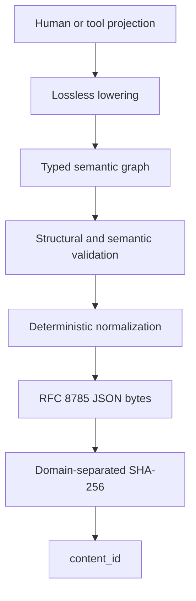

# RFC-0004: Canonical IR and Deterministic Encoding

- Status: Draft
- Version: 0.1
- Type: Foundational
- Depends on: RFC-0001, RFC-0002, RFC-0003
- Discussion target: Phase 0 canonical-representation review

## Abstract

RFC-0001 defines State, Transition, and Constraint as the semantic kernel.
RFC-0002 defines Claims, Evidence, information states, assurance, and execution
gates without adding a kernel primitive. RFC-0003 defines composition as
explicit graph structure with observable completion and failure semantics.

Those decisions are not yet interoperable until two independent implementations
can exchange the same program without inventing missing meaning.

This RFC defines a provisional Canonical IR data model, deterministic JSON
encoding, identity projection, content digest, reference model, unresolved-value
representation, extension policy, validation pipeline, and verifier interface.

The central rule is:

> Canonical bytes establish representation identity, not truth, authority,
> executability, or behavioral equivalence.

The initial design combines content-addressed **Block identity** with explicit
**Graph topology**. The whole semantic package is content-addressed. Nodes and
edges have stable local identities. The graph MAY contain cycles and is not
misrepresented as a Merkle DAG.



## 1. Decision proposed

Adopt the following Phase 0 Canonical IR profile:

1. The semantic document is a versioned, typed graph of State, Transition, and
   Constraint nodes plus explicit edges.
2. JSON is the initial interchange representation.
3. RFC 8785 JSON Canonicalization Scheme (JCS) is the initial canonical byte
   encoding.
4. The semantic identity projection contains `ir_version` and `semantic` only.
5. SHA-256 with an AI Native Core domain separator produces `content_id`.
6. Source layout, display labels, comments, and provenance references live in
   `annotations` and do not change `content_id`.
7. Missing, empty, not-applicable, unknown, ambiguous, and conflicting values
   remain distinct.
8. Executable semantics MUST NOT rely on omitted defaults.
9. Unknown semantic fields or unsupported semantic extensions cause rejection,
   not silent downgrade.
10. JSON Schema may validate structure, but it is not the semantic verifier.
11. Hash verification, structural validity, semantic validity, executable
    readiness, and evidence-backed authorization remain separate decisions.
12. Other codecs MAY be added later, but every accepted codec must round-trip
    to the same Canonical IR data model and initial JCS identity projection.

This is a concrete, falsifiable starting profile. It is not a claim that JSON is
the permanent or optimal storage format.

## 2. Scope

This RFC defines:

- the static program IR envelope;
- identity-bearing and non-identity-bearing projections;
- stable local identities and explicit references;
- State, Transition, Constraint, and composition node representation;
- typed expression and literal requirements;
- graph topology and collection ordering;
- empty, absent, unresolved, ambiguous, and conflicting semantics;
- deterministic normalization and JSON encoding;
- content digest construction;
- exported contract identity boundaries;
- versioning, extensions, and migrations;
- validation levels and machine-readable diagnostics;
- minimum verifier behavior;
- conformance and adversarial test vectors.

This RFC does not define:

- final human syntax;
- a complete JSON Schema;
- a complete type or constraint operator vocabulary;
- runtime State snapshots;
- an execution-trace or Evidence Bundle format;
- a package registry or network resolution protocol;
- signatures, trust roots, or authorization;
- a universal semantic-equivalence algorithm;
- a final semantic-patch protocol;
- a compiler, scheduler, or runtime ABI.

## 3. Normative language

The words MUST, MUST NOT, SHOULD, SHOULD NOT, and MAY describe requirements of
this proposal.

JSON fragments are provisional but normative where this RFC explicitly marks
field names, identity projections, or algorithms as required by profile
`aicore.ir/0.1`.

## 4. Representation layers

AI Native Core distinguishes five layers:

| Layer | Purpose | Identity-bearing |
|---|---|---|
| Human projection | Read, write, and review semantics | No |
| Canonical data model | Typed nodes, edges, contracts, and policies | Yes |
| Canonical bytes | Deterministic encoding of the identity projection | Yes |
| Annotation envelope | Labels, source maps, comments, provenance references | No |
| Runtime records | State, Claims, Evidence, invocations, and traces | Separate identity |

A parser or AI may accept several human projections. All accepted projections
must lower to the same Canonical IR when they assert the same explicit
representation.

Canonicalization does not make two behaviorally equivalent programs identical.
It makes one Canonical IR data model deterministic to encode.

## 5. Static IR envelope

The initial envelope is:

```json
{
  "ir_version": "aicore.ir/0.1",
  "content_id": "aicore-content-sha256:<64 lowercase hex characters>",
  "semantic": {
    "program_id": "program:example",
    "vocabularies": [],
    "imports": [],
    "types": [],
    "nodes": [],
    "edges": [],
    "entrypoints": [],
    "exports": [],
    "extensions": {}
  },
  "annotations": {
    "labels": [],
    "source_map": [],
    "provenance_refs": [],
    "extensions": {}
  }
}
```

For profile `aicore.ir/0.1`:

- every listed top-level field is required;
- every listed `semantic` field is required;
- every listed `annotations` field is required;
- a known-empty collection is encoded as `[]` or `{}`;
- `null` is used only where a field's schema explicitly defines
  not-applicable;
- unknown fields outside an extension container are invalid.

The empty document remains explicit. A decoder MUST NOT infer imports,
vocabularies, entrypoints, exports, policies, or extensions merely because a
collection is missing.

## 6. Identity model

The identity categories from RFC-0001 remain distinct.

### 6.1 Stable semantic names

`program_id`, `type_id`, `node_id`, `edge_id`, port identities, export
identities, and vocabulary identities are stable semantic names inside a
versioned program.

They are not claims of content equality.

Changing a local identity changes `content_id`, even when a reviewer believes
behavior is unchanged. A separate equivalence or contract claim may establish a
weaker identity relation.

### 6.2 Content identity

`content_id` identifies the exact versioned semantic projection defined in
Section 15.

It excludes annotations. It includes internal graph identities and topology.

### 6.3 Contract identity

`contract_id` identifies an exported contract projection, not the whole
program. It may remain stable while internal refinement changes.

The exact v0.1 export-projection algorithm is defined in Section 16.

### 6.4 Implementation and invocation identity

`implementation_id` identifies a concrete implementation artifact.
`invocation_id` identifies one runtime attempt.

Neither belongs in the static program `content_id` unless a program explicitly
constrains an implementation dependency by digest.

### 6.5 No universal semantic hash

The following implication is valid:

```text
same content_id and verified canonical bytes
  => same Canonical IR representation under this profile
```

The following implications are invalid:

```text
same content_id => program is correct
same content_id => evidence is trustworthy
different content_id => behavior must differ
same contract_id => implementations are universally equivalent
```

## 7. Identifier and reference requirements

### 7.1 Identifier profile

Core local identifiers MUST:

- contain ASCII characters only;
- be case-sensitive;
- begin with an ASCII letter;
- contain only letters, digits, `.`, `_`, `-`, and `:`;
- be between 1 and 128 bytes;
- be unique in their declared namespace.

The recommended convention is:

```text
program:order-fulfillment
type:payment-status
state:payment
transition:capture-payment
constraint:at-most-one-capture
edge:capture-indeterminate-to-reconcile
```

Display names in natural language belong in annotations.

### 7.2 Structured references

Semantic references MUST be structured, not parsed from display strings.

```json
{
  "node_id": "state:payment",
  "port_id": "current",
  "path": ["status"]
}
```

Every segment is exact and case-sensitive. A path is not a filesystem path.

### 7.3 Reference resolution

A local reference MUST resolve to exactly one compatible object.

Resolution outcomes are:

```text
RESOLVED
MISSING
AMBIGUOUS
KIND_MISMATCH
VERSION_MISMATCH
```

Only `RESOLVED` is link-valid. A tool MUST NOT choose the nearest spelling or
silently redirect a missing identity.

### 7.4 Imports

Every import MUST bind at least:

```text
import_id
content_id
required exports
version/profile constraints
```

Location is an annotation or resolver input. Location does not establish
identity. Resolving an import by mutable URL without verifying `content_id` is
invalid for executable use.

## 8. Kernel node representation

Every semantic node has:

```text
node_id
kernel_kind: state | transition | constraint
form
extensions
```

`form` identifies a projection such as `schema`, `action`, `transform`, `rule`,
`goal`, or `composition`. It does not add a kernel primitive.

### 8.1 State node

A State node declares a typed State interface or schema:

```json
{
  "node_id": "state:payment",
  "kernel_kind": "state",
  "form": "schema",
  "schema": {
    "type_id": "type:payment",
    "partial": true,
    "claimable_paths": []
  },
  "extensions": {}
}
```

`partial: true` permits an information state to lack values. It does not permit
a decoder to invent them.

Static State nodes define admissible shapes. Runtime values and Claims belong
to a separate State or Evidence Bundle identity.

### 8.2 Transition node

Every Transition node contains the complete applicable contract:

```json
{
  "node_id": "transition:example",
  "kernel_kind": "transition",
  "form": "action",
  "contract": {
    "inputs": [],
    "outputs": [],
    "preconditions": [],
    "outcomes": [],
    "postconditions": [],
    "effects": [],
    "required_capabilities": [],
    "preserved_constraints": [],
    "evidence_obligations": []
  },
  "composition": null,
  "extensions": {}
}
```

The collections above MUST NOT be omitted. An empty effect list means the
Transition declares no external effect. A missing effect list is invalid and
does not mean pure.

Every outcome has a stable `outcome_id`, output type, postconditions, effect
summary, and evidence obligations. The universal RFC-0003 Completion View is
separate from domain outcomes.

### 8.3 Constraint node

```json
{
  "node_id": "constraint:example",
  "kernel_kind": "constraint",
  "form": "rule",
  "constraint": {
    "scope": "trace",
    "expression": {
      "expr": "literal",
      "literal_type": "core:boolean",
      "value": true
    },
    "assurance_profile": null,
    "applies_to": [],
    "diagnostic_code": "AIC-RULE-EXAMPLE"
  },
  "extensions": {}
}
```

Constraint scopes are:

```text
state
step
trace
subgraph
program
```

A `goal`, assurance profile, or execution policy remains a Constraint form
when it restricts admissible State, Transition, Evidence, or execution-gate
decisions.

### 8.4 Composition node

Composition is represented as a Transition whose `composition` field is not
`null`.

```text
composition
  kind
  children
  selector
  commitment
  start_policy
  join_policy
  cancellation_policy
  synchronization
  retry_policy
  compensation_edges
  capability_delegation
  assurance_policy
  lifetime_scope
  observation_boundary
```

Fields not applicable to the selected composition kind are explicitly `null`.
Applicable known-empty fields are explicit collections.

Human nesting MUST lower to nodes and edges with stable identities. Source
nesting is an annotation, not canonical topology.

## 9. Type model

The initial IR requires named types with explicit definitions.

Minimum type forms are:

```text
unit
boolean
string
bytes
integer
decimal
enum
record
list
set
map
union
reference
```

Every field declares:

```text
field_id
type reference
required or optional
cardinality where applicable
```

`optional` means the domain admits absence. It does not mean unknown. A
required field whose value is not known must use an allowed unresolved
representation or fail validation for that profile.

### 9.1 Numeric values

Profile `aicore.ir/0.1` prohibits JSON numbers inside `semantic`.

Domain integers and decimals use typed canonical strings:

```json
{"literal_type":"core:integer","value":"42"}
{"literal_type":"core:decimal","value":"1250.5"}
```

Canonical integer lexical form has no leading `+`, no unnecessary leading
zero, and maps negative zero to `0`.

Canonical decimal lexical form:

- has no exponent;
- has no leading `+`;
- has no unnecessary integer leading zeros;
- has no trailing fractional zeros;
- omits the decimal point when the fractional part is zero;
- maps negative zero to `0`.

Precision, scale, currency, units, overflow, and rounding belong to the type or
Transition contract. They MUST NOT be inferred from a host language number.

### 9.2 Bytes and strings

Bytes use unpadded base64url in a typed literal.

Strings are exact Unicode scalar sequences encoded as UTF-8. The core profile
does not perform Unicode normalization on domain string values. Core
identifiers remain ASCII to avoid normalization and confusable-identity issues.

### 9.3 Type identity

Two type definitions with different `type_id` values are not representation-
identical merely because their present structures match.

Structural compatibility may be verified as a separate typed relation.

## 10. Expression representation

Executable predicates, guards, preconditions, and postconditions MUST use a
typed expression tree. They MUST NOT be stored only as opaque source strings.

Minimum expression forms are:

```text
literal
reference
operator application
quantifier
temporal operator
unknown sentinel where permitted
```

Example:

```json
{
  "expr": "apply",
  "operator": "core:eq",
  "arguments": [
    {
      "expr": "reference",
      "target": {
        "node_id": "state:payment",
        "port_id": "current",
        "path": ["status"]
      },
      "result_type": "type:payment-status"
    },
    {
      "expr": "literal",
      "literal_type": "type:payment-status",
      "value": "unknown"
    }
  ],
  "result_type": "core:boolean"
}
```

Every operator belongs to an exact supported vocabulary. Unknown operators are
invalid for semantic or executable verification.

The initial normalizer does not reorder commutative expression arguments,
simplify Boolean formulas, fold constants, or rewrite temporal logic. Those are
semantic transformations requiring explicit verifier evidence.

## 11. Graph topology

`semantic.nodes` and `semantic.edges` encode the program graph directly.

An edge has:

```text
edge_id
kind
from endpoint
to endpoint
condition
constraints
evidence obligations
extensions
```

Minimum edge kinds include:

```text
data
control
route
constraint_dependency
evidence_dependency
capability_delegation
compensation
refinement
```

An endpoint identifies a node and port. Route edges also identify a Completion
View or typed domain outcome.

### 11.1 Cycles are valid

Retry, reconciliation, long-running workflows, and reactive systems may create
cycles.

The Canonical IR is therefore a directed attributed graph, not necessarily a
directed acyclic graph.

The initial `content_id` hashes the whole semantic document. Per-node Merkle
identity is deferred because naive content-hash links cannot directly represent
cycles without an additional indirection or fixed-point scheme.

### 11.2 Edge identity

Edges have stable `edge_id` values so diagnostics and later semantic patches
can address topology without array-index dependence.

Parallel edges between the same endpoints are allowed when their identities
and semantics differ.

### 11.3 Outcome coverage

Every material Transition completion class and domain outcome MUST be exported,
routed, converted by a named policy, or declared unreachable with evidence.

Canonical topology MUST NOT infer a success route from source order.

## 12. Collection semantics

Every array field is declared as one of:

```text
ordered sequence
unordered set
tuple
```

The distinction is schema-level semantics.

For profile `aicore.ir/0.1`:

- `nodes`, `edges`, `types`, `imports`, `vocabularies`, `entrypoints`, and
  `exports` are sets and normalize by their stable identity;
- capability, effect, preserved-constraint, and evidence-obligation lists are
  sets unless a vocabulary explicitly declares order meaningful;
- expression arguments, tuples, and explicitly ordered policies preserve order;
- route priority is represented by explicit semantic structure, not incidental
  JSON array position.

Set members MUST be unique after normalization. Duplicate members are an error,
not an opportunity to select one.

## 13. Absence and incomplete meaning

The following are distinct:

| Representation | Meaning |
|---|---|
| field omitted | invalid, unless schema declares optional domain absence |
| `[]` or `{}` | known empty collection |
| `null` | explicitly not applicable where permitted |
| direct value | known representation value |
| unknown sentinel | value required but not currently established |
| ambiguous sentinel | multiple candidate meanings remain |
| conflicting sentinel | eligible claims disagree |

### 13.1 Unresolved sentinel

Where a schema explicitly permits `Resolvable<T>`, unresolved meaning is:

```json
{
  "$status": "unknown",
  "expected_type": "type:example",
  "reason_code": "missing-evidence",
  "details": {}
}
```

Ambiguity is:

```json
{
  "$status": "ambiguous",
  "expected_type": "type:example",
  "reason_code": "multiple-parses",
  "candidates": []
}
```

Conflict is:

```json
{
  "$status": "conflicting",
  "expected_type": "type:example",
  "reason_code": "eligible-claims-disagree",
  "claim_refs": []
}
```

Reserved `$` fields are legal only where the profile defines them.

### 13.2 Executable readiness

A draft IR may remain structurally valid with unresolved semantics.

An executable profile MUST reject any unresolved value that affects:

- type or reference resolution;
- an effect footprint;
- a required capability;
- an outcome or route;
- a hard Constraint;
- a selector, join, cancellation, retry, or compensation policy;
- an evidence or assurance obligation at the execution boundary.

This preserves the project rule:

> Unknown is better than invented semantics.

## 14. Deterministic normalization

Normalization converts a validated Canonical IR data model into the exact
identity projection used for canonical encoding.

The v0.1 pipeline is:

1. parse strict UTF-8 I-JSON;
2. reject duplicate object member names;
3. validate the exact IR version and allowed fields;
4. resolve and validate required vocabularies;
5. validate identifier uniqueness and reference syntax;
6. require all applicable fields, including known-empty collections;
7. normalize type-specific literal lexical forms;
8. normalize set-valued arrays by their declared key;
9. reject duplicates after normalization;
10. retain order for sequence and tuple arrays;
11. construct the identity projection from `ir_version` and `semantic`;
12. serialize that projection with RFC 8785 JCS.

### 14.1 Normalization is not optimization

The normalizer MUST NOT:

- invent a missing field or executable default;
- choose an ambiguous candidate;
- discard a conflicting claim;
- alpha-rename semantic identities;
- simplify expressions;
- reorder branches based on assumed commutativity;
- inline imports or refinements unless the profile requires it;
- remove an apparently redundant Constraint;
- infer purity, idempotency, or effect independence;
- prove behavioral equivalence.

### 14.2 Idempotence

For accepted Canonical IR `C`:

```text
normalize(normalize(C)) = normalize(C)
```

For canonical encoding `E` and decoding `D`:

```text
E(D(E(C))) = E(C)
```

Both equalities are byte equality under one exact IR profile.

## 15. Canonical bytes and content digest

### 15.1 Identity projection

The exact v0.1 identity projection is:

```json
{
  "ir_version": "aicore.ir/0.1",
  "semantic": {}
}
```

where `semantic` is the normalized semantic object from the envelope.

`content_id`, `annotations`, transport headers, filenames, repository paths,
and signatures are excluded.

### 15.2 Canonical JSON

The identity projection MUST satisfy I-JSON constraints and MUST be serialized
using RFC 8785 JCS.

JCS property sorting does not replace Section 12 collection normalization.
JSON object order is non-semantic; array order remains data and must already
reflect the field's declared sequence, tuple, or normalized-set semantics.

### 15.3 Digest construction

Let:

```text
C = UTF8(JCS(identity_projection))
P = ASCII("AI-NATIVE-CORE")
    || 0x00
    || ASCII("CONTENT")
    || 0x00
    || C
D = SHA-256(P)
```

Then:

```text
content_id = "aicore-content-sha256:" || lowercase_hex(D)
```

The domain separator prevents identical bytes used by another protocol or
identity class from being treated as the same AI Native Core content identity.

### 15.4 Verification

A consumer verifies `content_id` by:

1. parsing the envelope under the claimed exact profile;
2. reconstructing the normalized identity projection;
3. producing JCS bytes;
4. applying the domain-separated digest algorithm;
5. comparing the complete algorithm label and digest in constant time where
   security-sensitive.

A matching digest proves only representation integrity relative to the supplied
bytes and algorithm.

### 15.5 Hash agility

The algorithm name is part of the identity string. The initial profile supports
only `sha256`.

Adding another algorithm requires a registered profile update. A consumer MUST
NOT silently substitute an unsupported, truncated, or weaker digest.

## 16. Exported contract identity

Each export declares:

```text
export_id
root node
public inputs
public outputs and outcomes
public effects
required capabilities
hard constraints
evidence obligations
observation boundary
version
```

The v0.1 contract identity projection contains exactly those fields plus the IR
and vocabulary versions required to interpret them. It excludes:

- private nodes and edges;
- implementation refinements;
- source annotations;
- display labels;
- runtime evidence;
- content digest of the enclosing whole program.

The exact projection shape is:

```json
{
  "ir_version": "aicore.ir/0.1",
  "vocabularies": [],
  "export": {
    "export_id": "export:example-v1",
    "root_node_id": "transition:example",
    "public_inputs": [],
    "public_outcomes": [],
    "public_effects": [],
    "required_capabilities": [],
    "hard_constraints": [],
    "evidence_obligations": [],
    "observation_boundary": "boundary:example",
    "version": "1"
  }
}
```

The selected vocabulary entries and every set-valued export field are
normalized under Section 12 before JCS serialization.

The digest construction is the same as Section 15 except the domain label is
`CONTRACT` and the result prefix is:

```text
aicore-contract-sha256:
```

The exported contract projection retains public semantic identifiers. V0.1
does not attempt alpha-equivalence of renamed public interfaces.

Two equal contract identities establish equal normalized exported contracts,
not universal substitutability in every environment.

## 17. Annotations, source maps, and provenance

Annotations make the IR reviewable without controlling program meaning.

### 17.1 Labels

Labels may include:

```text
subject_id
language
display_name
description
tags
```

Changing a label does not change `content_id`.

If text changes runtime behavior, such as a model instruction or user-visible
message required by a contract, it is semantic content and MUST NOT be hidden in
annotations.

### 17.2 Source maps

Source maps bind semantic identities or fields to projection locations. A
source location may use RFC 6901 JSON Pointer where applicable, but semantic
identity remains the primary stable address.

Source maps do not authorize a tool to trust or execute the referenced source.

### 17.3 Provenance references

RFC-0002 Evidence or provenance records may be referenced by immutable digest.
Their eligibility remains policy- and context-dependent.

Excluding provenance references from `content_id` does not make provenance
irrelevant. It allows additional evidence to accumulate without pretending the
program meaning changed.

### 17.4 Annotation integrity

Applications that require exact annotations MAY compute a separate
representation digest or sign an envelope containing both semantic content and
annotations. That identity is not `content_id`.

## 18. Vocabulary and extension policy

### 18.1 Vocabularies

Every operator, effect kind, composition policy, type form, and assurance form
used by a program MUST belong to an exact vocabulary identity.

A vocabulary identity is immutable or content-addressed. A mutable name such as
`latest` is invalid for executable use.

The core profile requires at least:

```text
aicore.kernel/0.1
aicore.knowledge/0.1
aicore.composition/0.1
```

### 18.2 Semantic extensions

Anything that changes admitted State, Transition, Constraint, effect,
capability, evidence, or routing behavior is semantic.

Semantic extensions live under `semantic.extensions`, change `content_id`, and
are critical by definition. An unsupported semantic extension MUST cause
semantic and executable verification to fail.

### 18.3 Annotation extensions

Extensions that cannot change semantic behavior live under
`annotations.extensions`. They may be preserved or ignored by a consumer.

An extension MUST NOT label behavior-changing data as non-semantic to bypass
version or capability checks.

### 18.4 No unknown-field downgrade

JSON Schema's general treatment of unknown keywords as annotations is not the
AI Native Core semantic extension rule.

Unknown ordinary fields in a Canonical IR object are errors. Extensions must be
placed in the correct explicit container.

## 19. Versioning and migration

`ir_version` selects an exact data model, normalization algorithm, identity
projection, and required validation rules.

V0.1 does not assume that a reader for `0.1` can safely interpret `0.2`.

A migration is an explicit semantic transformation:

```text
migrate(old_content_id, migration_id)
  -> new_content_id
  + migration evidence
  + diagnostics
```

Migration MUST NOT overwrite history or retain an old `content_id` for changed
identity bytes.

Lossless migration should supply a scoped equivalence claim. Lossy migration
must identify lost or unresolved semantics.

## 20. Validation pipeline

Validation is layered so no single `valid: true` hides what was checked.

### 20.1 Levels

```text
PARSED
  strict JSON and I-JSON representation accepted

STRUCTURAL
  exact fields, shapes, identifiers, and literal forms accepted

LINKED
  imports and references resolve with compatible kinds and versions

TYPED
  ports, expressions, outcomes, and edges are type-compatible

SEMANTIC
  graph, effects, capabilities, Constraints, and policies satisfy static rules

EXECUTABLE_READY
  required meaning is resolved and the requested execution profile is supported
```

Integrity verification is reported independently:

```text
CONTENT_ID_MATCH | CONTENT_ID_MISMATCH | CONTENT_ID_UNSUPPORTED
```

A document can match its hash while being structurally or semantically invalid.

### 20.2 Required semantic checks

The first verifier SHOULD check at least:

- uniqueness of type, node, edge, port, entrypoint, and export identities;
- reference resolution and kind compatibility;
- complete Transition contract fields;
- port and outcome type compatibility;
- explicit effect and capability footprints;
- preserved Constraint references;
- composition completion-route coverage;
- selector, join, cancellation, lifetime, retry, and compensation policies;
- unsafe retry after indeterminate effectful attempts;
- compensation reachability and causal ordering;
- unsupported vocabularies and semantic extensions;
- unresolved meaning at the requested boundary;
- block boundary closure for imports and dependencies.

### 20.3 Runtime gates remain separate

`EXECUTABLE_READY` means the static program is sufficiently specified for a
runtime profile. It does not return `ALLOW` for a concrete effect.

RFC-0002 execution gates must still evaluate current State, Claims, Evidence,
capabilities, policy, and context immediately before the effectful invocation.

## 21. Verifier interface and diagnostics

Conceptual interface:

```text
verify(
  canonical_ir,
  requested_level,
  verifier_profile,
  import_resolver,
  optional_evidence_bundle
) -> VerificationReport
```

The report contains:

```text
subject content_id
verifier identity and version
supported IR and vocabulary versions
requested and completed levels
integrity result
diagnostics
assumptions
dependency identities
result: PASS | FAIL | INDETERMINATE
```

### 21.1 Diagnostic record

```json
{
  "code": "AIC-IR-ROUTE-001",
  "severity": "error",
  "subject_id": "transition:fulfill-order",
  "path": "/semantic/edges",
  "related_subjects": [],
  "arguments": {},
  "message": "Indeterminate completion has no route."
}
```

Machine decisions use stable `code`, subjects, paths, and typed arguments.
Localized message text is an annotation and MUST NOT be the sole routing key.

### 21.2 Deterministic reports

For the same subject, exact verifier, dependencies, profile, and assumptions, a
deterministic verifier SHOULD produce the same semantic diagnostic records.

Resource limits or incomplete solvers may return `INDETERMINATE`. They MUST NOT
invent `PASS`.

## 22. Codec requirements

JSON/JCS is the initial canonical encoding, not the semantic model itself.

A future codec `X` is conforming only if:

```text
decode_X(encode_X(C)) = C
JCS(identity_projection(decode_X(bytes)))
  = JCS(identity_projection(C))
```

Codec negotiation MUST NOT weaken unknown-field, numeric, extension, or
executable-readiness rules.

Deterministically encoded CBOR is a candidate compact transport. It is not a
v0.1 identity encoding, because supporting two independent canonical byte
encodings for one initial content identity would add avoidable complexity.

## 23. Semantic addressing and patching

RFC 6901 JSON Pointer can identify a representation location. RFC 6902 JSON
Patch can modify JSON locations. Neither alone expresses semantic intent or
stable node identity across set reordering.

Future semantic patches should target:

```text
base content_id
subject node_id or edge_id
typed field path
precondition over prior semantic value
typed semantic operation
expected result content_id where known
```

Patch application must be atomic with respect to the base `content_id`: if the
base differs, the patch must conflict or be explicitly rebased.

V0.1 does not define patch operations, but its stable identities and explicit
graph are designed to support them.

## 24. Validation case: payment reconciliation

The minimum machine-readable validation graph includes:

```text
CapturePayment
  SUCCEEDED      -> CreateShipment
  FAILED         -> require authoritative no-capture evidence
  CANCELLED      -> inspect known and unknown effects
  INDETERMINATE  -> ReconcilePayment

ReconcilePayment
  succeeded with accepted receipt -> CreateShipment
  authoritative no-capture        -> ReleaseInventory
  indeterminate                   -> manual or unresolved terminal state
```

Required Constraints include:

```text
AtMostOneCapture
NoShipmentWithUnknownPayment
ChargeCreatesObligation
```

The vector must fail semantic validation if:

- the indeterminate route is removed;
- a retry creates a new payment intent without safety evidence;
- `CreateShipment` loses its accepted-receipt precondition;
- the payment capability is omitted;
- a `FAILED` Completion View is treated as proof of no capture;
- compensation is declared without its own failure and indeterminate routes.

The companion human projection is
[`order-fulfillment.aicore`](./order-fulfillment.aicore). The companion
Canonical IR vector is
[`order-fulfillment.ir.json`](./order-fulfillment.ir.json).

Its expected v0.1 content identity is:

```text
aicore-content-sha256:c751e0f43bcd5293e4266010ac28e9addabc60d7740a5bd342b286d6f89d875f
```

The vector contains a bounded self-edge for read-only payment reconciliation so
an implementation must preserve a real graph cycle rather than assuming all
programs are DAGs.

## 25. Canonicalization test properties

Every reference implementation MUST include tests demonstrating:

| Change | Expected result |
|---|---|
| JSON whitespace changes | same `content_id` |
| JSON object member order changes | same `content_id` |
| set-valued input array order changes before normalization | same `content_id` |
| ordered sequence changes | different `content_id` |
| annotation-only label changes | same `content_id` |
| semantic node, edge, type, or policy changes | different `content_id` |
| omitted required empty list | structural failure |
| `null` used for unknown | structural failure |
| unresolved sentinel replaces known value | different `content_id`; usually not executable-ready |
| unsupported semantic extension | semantic failure |
| duplicate object key | parse failure |
| duplicate stable identity | structural failure |
| claimed digest altered | content-ID mismatch |

At least one test graph MUST contain a cycle to prevent accidental DAG-only
implementations.

## 26. Alternatives considered

### 26.1 Nested syntax tree as canonical form

Rejected for v0.1. Nesting makes shared dependencies, compensation edges,
cycles, and stable patch targets harder to address. Human syntax may remain
nested while lowering to an explicit graph.

### 26.2 Per-node Merkle DAG

Deferred. Content-addressed nodes are attractive for reuse and partial loading,
but naive hash references cannot directly represent cycles. Whole-document
content addressing is simpler and falsifiable. A future block graph may add
indirection, strongly connected component hashing, or another proven scheme.

### 26.3 Hash of normalized behavior

Rejected. General behavioral equivalence is not automatically decidable, and
observation boundaries differ. V0.1 hashes representation or exported contract
projections, never universal meaning.

### 26.4 `null` for missing or unknown

Rejected. It collapses domain null, not-applicable, absent, and unknown.

### 26.5 Protocol Buffers as the first canonical encoding

Deferred. Schema-driven binary encoding is compact, but the project first needs
a directly inspectable research artifact and strict semantic handling of
unknown fields. A later codec may use a binary schema after the data model
stabilizes.

### 26.6 CBOR as the first canonical encoding

Deferred. RFC 8949 provides deterministic encoding rules and CBOR is a strong
future transport. JSON/JCS currently lowers the implementation and review
barrier for early cross-language experiments.

### 26.7 JSON-LD or RDF as the canonical model

Deferred. Global linked-data semantics and graph canonicalization may become
useful for interop, but introduce vocabulary, context, blank-node, and
canonicalization complexity beyond the current minimal kernel experiment.

### 26.8 Silently ignoring unknown semantic fields

Rejected. Forward compatibility that changes behavior into something an older
executor merely *thinks* it understands is unsafe.

## 27. Related standards and designs

### 27.1 I-JSON

RFC 7493 defines an interoperable JSON profile, including UTF-8 and restrictions
intended to improve predictable processing.

- Tim Bray,
  [The I-JSON Message Format](https://www.rfc-editor.org/rfc/rfc7493), 2015.

### 27.2 JSON Canonicalization Scheme

RFC 8785 defines deterministic JSON primitive serialization and object-property
sorting suitable for repeatable hashing.

- Anders Rundgren, Bret Jordan, and Samuel Erdtman,
  [JSON Canonicalization Scheme](https://www.rfc-editor.org/rfc/rfc8785),
  2020.

### 27.3 JSON Schema

JSON Schema Draft 2020-12 provides structural description, reference, dialect,
and vocabulary mechanisms. AI Native Core uses it as a candidate structure
validator, not as the entire semantic-verification language.

- JSON Schema,
  [Draft 2020-12 Core](https://json-schema.org/draft/2020-12/json-schema-core).

### 27.4 JSON Pointer and JSON Patch

RFC 6901 identifies JSON values. RFC 6902 describes ordered JSON modification
operations. They inform diagnostics and transport patches but do not replace
stable semantic addressing.

- [JSON Pointer](https://www.rfc-editor.org/rfc/rfc6901)
- [JSON Patch](https://www.rfc-editor.org/rfc/rfc6902)

### 27.5 Deterministic CBOR

RFC 8949 defines core deterministic CBOR encoding requirements and highlights
protocol choices that must remain explicit.

- Carsten Bormann and Paul Hoffman,
  [Concise Binary Object Representation](https://www.rfc-editor.org/rfc/rfc8949),
  2020.

### 27.6 Secure Hash Standard

SHA-256 is defined by NIST FIPS 180-4. The digest detects content changes; it
does not authenticate an author or prove semantic validity.

- NIST,
  [Secure Hash Standard](https://doi.org/10.6028/NIST.FIPS.180-4).

### 27.7 Content-addressed data models

Multiformats and IPLD demonstrate self-describing content identifiers, typed
data models, and content-addressed graph links. RFC-0004 adopts the separation
of content identity from location while deferring their exact CID and DAG
profiles.

- [Multiformats](https://multiformats.io/)
- [IPLD Data Model](https://ipld.io/docs/data-model/)

## 28. Security considerations

### 28.1 Digest confusion

The domain separator, full algorithm label, exact IR version, and identity
projection must be checked. A digest from another protocol or identity class
must not be substituted.

### 28.2 Content identity is not authenticity

Anyone can compute `content_id`. Signatures, trust roots, repository policy,
and author identity remain separate.

### 28.3 Duplicate member and identity attacks

Duplicate JSON member names and duplicate semantic identities MUST be rejected.
Selecting first or last allows different parsers to see different programs.

### 28.4 Numeric ambiguity

Host-language floating point, unsafe integers, exponent spelling, negative
zero, NaN, and infinity can cause inconsistent interpretation. Semantic JSON
numbers are prohibited in v0.1.

### 28.5 Unicode confusion

Core identifiers are ASCII. User-facing Unicode labels do not determine
identity. Domain string equality remains exact and must not be normalized by an
unannounced codec policy.

### 28.6 Extension smuggling

Behavior-changing content hidden in annotations or an unsupported extension
must not influence execution. Unknown semantic extensions fail closed.

### 28.7 Resolver substitution

Imports and vocabularies must be verified by immutable identity. Network
location, cached display name, or a successful HTTP response does not establish
content identity.

### 28.8 Resource exhaustion

Parsers and verifiers must bound input size, nesting depth, node and edge count,
reference expansion, import depth, expression complexity, and cyclic analysis.
Limit exhaustion returns a diagnostic or `INDETERMINATE`, not `PASS`.

### 28.9 Canonicalization disagreement

Implementations must publish test vectors and exact supported profiles. A
consumer must reject a claimed identity when its canonicalizer cannot reproduce
the digest.

### 28.10 Annotation injection

Source labels and diagnostics may contain untrusted text. Tools must not treat
annotation text as executable policy, HTML, shell input, or semantic operator.

## 29. Minimum conformance

An implementation claiming experimental RFC-0004 v0.1 conformance MUST:

1. parse strict UTF-8 I-JSON and reject duplicate member names;
2. require the exact envelope and semantic fields;
3. reject unknown fields outside extension containers;
4. distinguish empty, not-applicable, unknown, ambiguous, and conflicting;
5. support stable local identities and structured references;
6. represent State, Transition, and Constraint node kinds;
7. represent composition as attributed Transition graph structure;
8. preserve cycles in the semantic graph;
9. use typed expressions rather than executable predicate strings;
10. prohibit JSON numbers in `semantic`;
11. normalize declared sets while preserving sequences and tuples;
12. produce the exact Section 15 identity projection;
13. produce RFC 8785 canonical bytes;
14. compute and verify the domain-separated SHA-256 `content_id`;
15. exclude annotations from `content_id`;
16. reject unsupported vocabularies and semantic extensions for semantic use;
17. report integrity separately from structural and semantic validity;
18. provide stable machine-readable diagnostic codes and subjects;
19. detect unresolved required semantics before executable readiness;
20. check outcome routing, effects, capabilities, retry, and compensation fields;
21. verify imports by identity rather than location;
22. pass the Section 25 canonicalization properties and published vectors.

## 30. Falsification criteria

This proposal is weakened or falsified if:

1. independent implementations cannot reproduce canonical bytes and digests;
2. explicit graph nodes and fields create prohibitive context cost for AI or
   human review;
3. the representation cannot encode a required RFC-0001 through RFC-0003 case;
4. the unresolved-value model still permits invented executable meaning;
5. strict extension handling prevents practical evolution without a safe
   replacement;
6. JSON/JCS numeric or Unicode constraints remain too fragile despite typed
   literals and ASCII identifiers;
7. whole-document hashing prevents useful local editing or reuse before a safe
   cyclic block scheme is available;
8. contract projections cannot remain stable across useful refinements;
9. structural and semantic validation cannot be separated consistently;
10. another representation yields materially lower ambiguity and context cost
    while retaining open implementation and deterministic identity.

Any replacement should publish the same adversarial vectors and compare:

- representation size;
- AI token and retrieval cost;
- human review cost;
- deterministic cross-language behavior;
- unknown and extension safety;
- graph and cycle support;
- semantic patch addressability;
- verifier complexity.

## 31. Open questions

1. Should the final identifier syntax adopt multihash or CID directly?
2. When is per-node content addressing worth the complexity of cyclic graphs?
3. Should strongly connected components become content-addressed blocks?
4. Which exact type and expression vocabulary is sufficient for Phase 1?
5. Should domain string types optionally declare a Unicode normalization form?
6. How should recursive types and generic parameters be represented?
7. Which fields belong in the first exported contract projection?
8. Can private-identity alpha-renaming produce a useful stronger contract
   normalization without implying behavioral equivalence?
9. Should source maps use JSON Pointer, byte spans, syntax-node identities, or
   multiple projections?
10. What signature envelope should bind authorship to content and annotations?
11. How should evidence bundles reference partial graph subjects?
12. What is the minimum safe import-resolution protocol?
13. Should a later binary codec use deterministic CBOR, Protobuf, or a purpose-
    built block encoding?
14. How should semantic patches address type-safe graph rewrites?
15. Which diagnostics must be normative for the first benchmark?

## 32. Consequences of adoption

If accepted for Phase 0:

- the project has a concrete end condition for “canonical”;
- program identity becomes reproducible without claiming universal meaning;
- Block identity and Graph topology become explicit architectural layers;
- cyclic workflows remain representable;
- hidden defaults and silent extension downgrades become invalid;
- human syntax can evolve without changing canonical semantics accidentally;
- annotations and evidence can grow without changing program content identity;
- Phase 1 can implement a parser, normalizer, serializer, and diagnostic
  verifier against published vectors;
- semantic patching gains stable node and edge targets;
- compact binary codecs remain possible after the semantic model stabilizes.

The cost is deliberate verbosity in the machine form. Human projections and
tooling must hide that cost without hiding meaning.

## 33. Current conclusion

The current working position is:

> AI Native Core should encode meaning as an explicit typed graph, seal the
> versioned semantic package with deterministic content identity, and keep
> annotations, evidence, execution, and equivalence as separate layers. The
> hash must prove exactly what it can prove—and nothing more.
