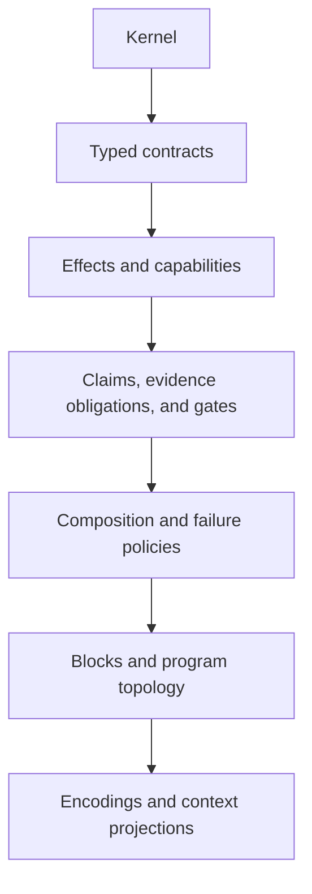

# RFC-0005: Semantic Blocks, Layered IR, and Context Projections

- Status: Draft
- Version: 0.1
- Type: Foundational amendment
- Depends on: RFC-0001, RFC-0002, RFC-0003, RFC-0004
- Amends: RFC-0001 Sections 10 and 13; RFC-0004 Sections 5, 8, 12, 14, 15, and 22
- Discussion target: Phase 0 semantic-density and retrieval review

## Abstract

RFC-0001 through RFC-0004 progressively expose the semantic information needed
for reliable AI-assisted programs. The result is explicit and auditable, but the
first machine validation vector also exposes heavy representational repetition.

The current human order projection is 9,609 bytes. Its pretty JSON validation
vector is 41,119 bytes, and the JCS identity projection is 22,466 bytes even
though the machine vector covers a narrower payment-reconciliation slice.

This RFC separates the canonical semantic model from four projections that have
different jobs:

```text
authoring projection
compact canonical encoding
expanded audit projection
purpose-bounded context projection
```

It also restores the earlier Block + Graph + Genome architecture:

- a Semantic Block is an interface-closed subgraph;
- each Block has stable semantic identity and independent content identity;
- a Program Genome manifest binds Block versions and cross-Block topology;
- the topology may contain cycles;
- an AI receives a declared semantic neighborhood rather than the whole genome
  by default.

The central rule is:

> Explicit meaning does not require repeated scaffolding. A compact encoding may
> omit only what an exact profile can reconstruct uniquely, while every
> semantically variable safety boundary remains verifiable.

The measurements, errata, and design critique motivating this amendment are in
the [Phase 0 Retrospective](./PHASE-0-RETROSPECTIVE.md).

## 1. Decision proposed

Adopt the following amendments for the next experimental IR profile:

1. State, Transition, and Constraint remain the only kernel concepts.
2. Types, contracts, knowledge, effects, capabilities, composition, identity,
   and codecs are semantic layers or forms, not new primitives.
3. A Semantic Block is an interface-closed subgraph, not necessarily one
   Transition.
4. Blocks are independently content-addressed.
5. A Program Genome manifest binds Block identities, Block content identities,
   cross-Block edges, entrypoints, and exports.
6. Semantic topology may contain cycles and MUST NOT be forced into a Merkle
   DAG.
7. The compact canonical encoding MAY omit schema-invariant empty or
   not-applicable fields.
8. Deterministic expansion MUST reconstruct exactly one expanded audit model.
9. Semantically variable effects, capabilities, outcomes, routes, and
   uncertainty policies MUST remain explicit or mechanically derivable from
   explicit graph structure.
10. Maps keyed by stable semantic identities SHOULD replace arrays that repeat
    `node_id`, `edge_id`, or similar keys.
11. AI and human tasks SHOULD consume purpose-bounded Context Bundles.
12. A Context Bundle MUST declare its dependency cut and completeness.
13. Budget exhaustion MUST return incomplete context, never silent truncation.
14. Runtime State, Evidence, invocations, and traces remain separate bundles.
15. RFC-0004's current JSON vector is reclassified as an expanded audit and
    content-identity prototype, not a stable compact wire format.

## 2. Scope

This RFC defines:

- the semantic-layer model;
- the revised Semantic Block boundary;
- independent Block content identity;
- the Program Genome manifest;
- cyclic cross-Block topology;
- four static projections;
- compact omission and deterministic expansion rules;
- stable map-key addressing;
- purpose-bounded semantic-neighborhood queries;
- dependency closure and explicit cut boundaries;
- Context Bundle completeness and identity;
- revised uncertainty terminology;
- minimum context and semantic-density benchmarks;
- amendments to earlier draft requirements.

This RFC does not define:

- final compact JSON field names;
- a final JSON Schema;
- a tokenizer-independent compression metric;
- a general program-slicing algorithm;
- runtime scheduling or execution;
- a universal relevance model;
- a final package registry;
- a final Block-size heuristic;
- a final binary codec;
- model-specific prompt templates.

## 3. Normative language

The words MUST, MUST NOT, SHOULD, SHOULD NOT, and MAY describe requirements of
this proposal.

Examples use a provisional compact JSON projection. They demonstrate structure,
not stable field spelling.

## 4. Semantic layers

The kernel remains intentionally small:

```text
State
Transition
Constraint
```

Practical programs require additional structure, but additional structure does
not automatically imply additional primitives.



### 4.1 Kernel layer

Defines admissible State, Transition relations, and Constraints.

### 4.2 Contract layer

Defines typed inputs, outputs, domain outcomes, preconditions, postconditions,
and interface boundaries.

### 4.3 Effect and authority layer

Defines observable effects, resource footprints, required capabilities,
delegation, and effect-specific restrictions.

### 4.4 Knowledge and assurance layer

Defines claim shapes, Evidence obligations, information views, assurance
profiles, and execution-gate requirements.

Actual Evidence instances remain outside the static program identity.

### 4.5 Orchestration layer

Defines selection, ordering, concurrency, synchronization, timeout,
cancellation, retry, reconciliation, and compensation topology.

### 4.6 Representation layer

Defines stable identities, codecs, source maps, compact encodings, expanded
views, and Context Bundles.

Layering allows a pure calculator Block to avoid carrying payment-reconciliation
policy while remaining part of the same semantic model.

## 5. Revised Semantic Block

A Semantic Block is:

> An interface-closed semantic subgraph whose internal meaning can be understood
> and verified from its content plus explicitly declared boundary dependencies.

A Block MAY contain one Transition. It MAY also contain several State,
Transition, and Constraint nodes.

Source files, classes, functions, services, and deployment units may project to
Blocks, but none defines the boundary automatically.

### 5.1 Block boundary contract

Every Block MUST declare:

```text
block_id
input ports
output and outcome ports
external effects
required and delegated capabilities
exported Constraints
imported Constraint dependencies
Evidence and assurance dependencies
cross-boundary State/type dependencies
observation boundary
unresolved dependencies
```

A dependency is valid only when it is:

1. contained in the Block; or
2. exposed in the boundary contract; or
3. bound by the Program Genome manifest to an immutable dependency.

### 5.2 Local closure is purpose-relative

No useful Block is globally self-sufficient. A Block is locally closed for a
declared verification or execution profile.

For example, payment capture may be closed for static effect checking while
still depending on runtime gateway Evidence for execution.

### 5.3 Block cohesion

A proposed Block SHOULD be rejected or split when:

- unrelated effects share no interface or Constraint;
- most internal nodes are retrieved independently;
- a small change invalidates many unrelated consumers;
- the boundary exposes nearly every internal detail;
- verification cannot avoid loading unrelated subgraphs.

A proposed Block SHOULD be merged when its separated parts cannot be understood
or verified without repeatedly retrieving one another.

These are measurable design heuristics, not kernel laws.

## 6. Block identity

Each Block has two primary identities:

```text
block_id
  stable semantic identity within the Program Genome

block_content_id
  digest of the exact normalized Block semantic payload
```

Changing a display label does not change `block_content_id`. Changing a Block
contract, internal semantic graph, or required dependency does.

### 6.1 Block identity projection

The experimental identity projection contains:

```text
IR profile
required vocabularies
block_id
boundary contract
internal types used by identity
internal State / Transition / Constraint graph
declared dependency identities
semantic extensions
```

It excludes:

- display labels;
- source positions;
- comments;
- mutable locations;
- runtime State and Evidence;
- enclosing program identity.

### 6.2 Block digest

The digest follows RFC-0004's canonicalization and domain-separation approach
with the domain label `BLOCK`:

```text
P = ASCII("AI-NATIVE-CORE")
    || 0x00
    || ASCII("BLOCK")
    || 0x00
    || canonical_block_bytes

block_content_id = "aicore-block-sha256:" || lowercase_hex(SHA-256(P))
```

This is representation identity, not correctness or authorship.

### 6.3 Local change behavior

A change inside Block `A` changes:

- `A.block_content_id`;
- the Program Genome manifest content identity;
- dependent verification claims whose subjects or assumptions include `A`.

It does not change unrelated Block content identities.

## 7. Program Genome manifest

The Program Genome is not one recursively nested JSON object. It is a manifest
plus content-addressed Blocks.

Minimum manifest semantic fields:

```text
program_id
IR profile and vocabularies
block bindings: block_id -> block_content_id
cross-Block typed edges
entrypoints
exports
program Constraints
semantic extensions
```

`program_id` is the stable semantic identity. The computed
`program_content_id` accompanies the manifest but is excluded from the bytes it
identifies.

### 7.1 Manifest binding

A cross-Block edge refers to stable `block_id` and port identities. The manifest
binds that `block_id` to the exact `block_content_id` used by the program.

A resolver MUST verify both the stable identity and content digest.

### 7.2 Program content identity

The experimental Program content identity hashes the normalized manifest
identity projection under domain label `PROGRAM`:

```text
P = ASCII("AI-NATIVE-CORE")
    || 0x00
    || ASCII("PROGRAM")
    || 0x00
    || canonical_manifest_identity_bytes

program_content_id = "aicore-program-sha256:"
                     || lowercase_hex(SHA-256(P))
```

The identity projection includes stable `program_id` but excludes the computed
`program_content_id`, annotations, mutable locations, and runtime records.

The manifest digest transitively binds Block content through the explicit
`block_id -> block_content_id` map.

### 7.3 Cycles remain valid

Semantic cycles are represented by manifest edges between stable Block
identities:

```text
Plan -> Execute -> Observe -> Replan
```

or:

```text
Capture -> Reconcile -> Reconcile
```

Block payloads do not recursively contain the Program manifest digest. The
semantic topology can therefore contain cycles without a hash fixed point.

The manifest itself is content-addressed, but the semantic graph it describes
is not required to be a DAG.

## 8. Four static projections

One representation should not serve every audience and operation.

### 8.1 Authoring projection

Optimized for human and AI construction:

- readable names;
- concise semantic forms;
- local nesting where useful;
- comments and source organization;
- unresolved authoring placeholders;
- immediate diagnostics.

It is not content identity until parsed, resolved, normalized, and verified.

### 8.2 Compact canonical encoding

Optimized for deterministic identity, interchange, and storage:

- stable map keys;
- no display-only text;
- one exact normalized form;
- schema-invariant empties omitted;
- semantically variable fields explicit;
- content-addressed dependencies;
- deterministic ordering and literal encoding.

### 8.3 Expanded audit projection

Optimized for inspection and verification:

- every applicable field present;
- schema-derived empties shown;
- resolved references shown with provenance;
- normalized sets and paths visible;
- diagnostics attached to exact subjects;
- no claim that the view is context-efficient.

RFC-0004's current `order-fulfillment.ir.json` is best treated as this kind of
projection.

### 8.4 Purpose-bounded Context Bundle

Optimized for a declared task:

```text
understand
edit
verify
refine
execute-gate
diagnose
```

It contains the focus subjects and the dependency closure required by the
purpose/profile, subject to a declared boundary and budget.

## 9. Deterministic compact expansion

Let:

```text
C = compact canonical encoding
A = expanded audit projection
expand(C) = A
compact(A) = C
```

For valid canonical data:

```text
compact(expand(C)) = C
expand(compact(A)) = normalize_audit(A)
```

The expansion and compaction algorithms are versioned semantics. They are not
UI convenience functions.

### 9.1 Safe omission

A field may be omitted from compact encoding only when all are true:

1. the exact IR profile determines whether the field is applicable;
2. its value is uniquely determined by node form or schema;
3. expansion requires no State, Evidence, policy, environment, or heuristic;
4. omission cannot alter admitted outcomes, effects, capabilities, Constraints,
   routes, or execution decisions;
5. an expanded audit view restores the field.

Examples of potentially safe compact omissions:

```text
transform.external_effects = []
leaf_transition.composition = not_applicable
node.semantic_extensions = {}
```

Examples that MUST NOT be inferred through omission:

```text
action effect footprint
action required capabilities
material domain outcomes
completion routes
retry safety policy
parallel join/cancellation/interference policy
compensation restoration contract
required assurance profile
unknown or ambiguous semantic choice
```

### 9.2 Explicit empty is not proof of review

An author can write `effects: []` without understanding an effect just as easily
as omitting the field.

Safety must come from:

- form-specific schema requirements;
- effect inference diagnostics where sound;
- integration declarations;
- review policy;
- static and runtime Evidence;
- adversarial validation.

Mechanical repetition alone is not assurance.

## 10. Stable keyed maps

Compact encoding SHOULD store identity-bearing sets as maps keyed by stable
identities.

Instead of:

```json
{
  "nodes": [
    {
      "node_id": "transition:capture-payment",
      "kernel_kind": "transition",
      "form": "action"
    }
  ]
}
```

prefer an experimental form similar to:

```json
{
  "transitions": {
    "capture-payment": {
      "form": "action",
      "inputs": {
        "order": "Order",
        "reservation": "InventoryReservation"
      },
      "outcomes": {
        "captured": "Receipt",
        "not-captured": "Reason"
      },
      "effects": ["payment.capture"],
      "capabilities": ["payment.capture"],
      "preserves": [
        "AtMostOneCapture",
        "ChargeCreatesObligation"
      ]
    }
  }
}
```

The stable map key supplies the local identity once. The expanded audit view may
restore fully qualified `node_id` and `kernel_kind` fields.

### 10.1 Map restrictions

Keyed maps MUST:

- reject duplicate keys;
- use the identifier profile selected by the IR version;
- define namespace and qualification rules;
- avoid display names as keys;
- produce deterministic key ordering for canonical bytes;
- support unambiguous structured references.

### 10.2 When arrays remain necessary

Arrays remain appropriate for:

- ordered sequences;
- tuples;
- expression arguments where order is semantic;
- traces;
- policy priority lists.

Unordered semantic sets should not depend on array position.

## 11. Revised uncertainty terminology

The following terms are scoped and MUST NOT be used interchangeably:

| Term | Scope | Meaning |
|---|---|---|
| `ABSENT` | Domain/value | The domain permits no value at this position |
| `UNRESOLVED` | Authoring IR | Required semantic content has not been supplied or resolved |
| `UNKNOWN` | Claim information | Eligible evidence supports neither assertion nor denial |
| `AMBIGUOUS` | Interpretation | More than one candidate meaning remains |
| `CONFLICTING` | Claim information | Eligible evidence supports both sides |
| `INDETERMINATE` | Completion/verifier result | The process cannot establish a more specific result under its profile |

### 11.1 Domain status

A domain enum SHOULD NOT use `unknown` merely to represent missing knowledge of
a physical status.

Prefer:

```text
PaymentAttempt.observation = outcome_unresolved
information(PaymentSucceeded) = UNKNOWN
completion(CapturePayment) = INDETERMINATE
```

If `unknown` is a real domain status defined by an external protocol, its domain
meaning must be stated explicitly.

### 11.2 Context projection status

Context completeness uses its own values:

```text
COMPLETE
BOUNDED_WITH_DECLARED_CUT
INCOMPLETE
```

It does not reuse claim `UNKNOWN` or Transition `INDETERMINATE`.

## 12. Context query

Conceptual interface:

```text
project_context(
  program_content_id,
  focus_subjects,
  purpose,
  verifier_profile,
  relation_policy,
  budget
) -> ContextBundle
```

### 12.1 Focus subjects

Focus may identify:

- Blocks;
- State/type paths;
- Transitions or outcomes;
- Constraints;
- effects or capabilities;
- diagnostics;
- semantic patch targets.

### 12.2 Purpose profile

Purpose determines which dependency relations are required.

For example, `edit` normally requires incoming and outgoing dependencies, while
`understand-export` may begin from an exported contract and expand only on
demand.

Purpose MUST NOT weaken hard safety dependencies.

### 12.3 Budget

Budget may constrain:

```text
bytes
model tokens for a named tokenizer
Block count
graph distance
retrieval time
verification cost
```

The bundle records the exact budget unit and observed use.

## 13. Dependency closure

For a focus set `F` and purpose profile `P`, the required semantic neighborhood
is the least fixed point containing `F` and every dependency required by `P`.

Required relation classes may include:

```text
type and schema reference
data flow
control and outcome route
precondition and postcondition
hard Constraint application
effect footprint
capability requirement and delegation
Evidence or assurance obligation
retry and reconciliation relation
compensation relation
refinement relation
import binding
```

### 13.1 No global transitive expansion by default

Not every reachable relation is relevant to every purpose. Otherwise the
neighborhood becomes the whole program.

The profile declares which relations are:

```text
mandatory transitive
mandatory one-hop
summary-eligible
optional
excluded
```

Hard Constraint, effect, capability, and outcome-route dependencies MUST NOT be
excluded from a verification or execution-gate bundle merely to satisfy budget.

### 13.2 Cyclic closure

The algorithm tracks visited semantic identities and content identities. A
cycle is recorded once in topology and does not cause unbounded expansion.

### 13.3 Summary use

A summary may replace an expanded dependency only when:

- the purpose profile permits it;
- the summary has a stable subject and method;
- omitted details remain addressable;
- required hard claims are preserved;
- the bundle marks the summary boundary;
- executable policy accepts the summary's assurance.

AI-generated free text alone is not a sufficient semantic summary for an
effectful execution gate.

## 14. Context Bundle

A Context Bundle contains:

```text
bundle_id
program content identity
query and purpose profile
focus subjects
included Block bindings
included semantic objects
included summaries
cut-boundary dependencies
completeness
budget and use
normalizer/projector identity
diagnostics
annotations
```

### 14.1 Cut boundary

Every omitted dependency crossing the included graph boundary is recorded with:

```text
source subject
relation kind
target stable identity
target content identity when known
reason omitted
whether mandatory for a stronger profile
resolution action
```

### 14.2 Completeness

`COMPLETE` means the bundle contains the full dependency closure for the exact
query and purpose profile.

`BOUNDED_WITH_DECLARED_CUT` means the profile permits a bounded view and every
cut dependency is explicitly represented.

`INCOMPLETE` means a mandatory dependency could not be included, resolved, or
verified.

An effectful execution gate MUST `DEFER` or `DENY` on `INCOMPLETE` context.

### 14.3 Bundle identity

Context Bundle identity includes:

- exact program identity;
- exact query/profile;
- included semantic content identities;
- summaries and cut records;
- completeness and projector identity.

Annotations and localized display text remain outside semantic bundle identity.

## 15. Progressive disclosure

Tools SHOULD expose semantic information in levels:

```text
Level 0  exported contract and current diagnostics
Level 1  focus Block and boundary
Level 2  required semantic neighborhood
Level 3  expanded audit details
Level 4  runtime Evidence and trace neighborhood
```

The levels are views, not trust levels.

An AI may request expansion by stable subject identity rather than receiving an
unbounded dump at the beginning of every task.

## 16. Constraint taxonomy requirement

Constraint remains a kernel concept, but every Constraint form MUST declare:

```text
form identity
subject kinds
scope: state | step | trace | subgraph | program
evaluation domain
result algebra
enforcement boundary
required dependencies
```

Examples:

| Form | Evaluation result | Enforcement |
|---|---|---|
| State invariant | `SATISFIED / VIOLATED / UNKNOWN / CONFLICTING` | State acceptance |
| Trace property | Same plus bounded-analysis `INDETERMINATE` | Trace/program verification |
| Goal | Reachability/liveness result | Planning or acceptance |
| Assurance profile | Evidence eligibility and claim result | Verification boundary |
| Execution policy | `ALLOW / DENY / DEFER` | Invocation gate |

The different result algebras MUST NOT be collapsed into a single Boolean.

## 17. Amendments to previous RFCs

### 17.1 RFC-0001 explicit-empty rule

The expanded semantic model still distinguishes absent, empty, not-applicable,
and unresolved.

The compact encoding may omit a schema-invariant empty or not-applicable field
under Section 9. This amends the requirement that every empty contract field be
physically repeated in every canonical interchange document.

### 17.2 RFC-0001 Block definition

The interface-closed subgraph definition governs. A single Transition is one
possible Block, not the universal Block shape.

### 17.3 RFC-0001 parallel erratum

The symmetric sufficient data-independence conditions are:

```text
W(A) intersect (R(B) union W(B)) = empty
W(B) intersect (R(A) union W(A)) = empty
```

RFC-0003 already contains the corrected form.

### 17.4 RFC-0002 unknown terminology

`UNKNOWN` is an information value for a scoped claim. It is not automatically a
domain State enum, Completion View, verifier result, or unresolved authoring
field.

### 17.5 RFC-0003 behavior remains

Compact encoding does not weaken explicit completion routes, concurrency
policies, retry safety, cancellation evidence, or compensation contracts.

### 17.6 RFC-0004 representation status

RFC-0004's identity principles and deterministic encoding experiment remain
useful.

Its v0.1 JSON object shape is an expanded prototype. The next compact profile
must publish a deterministic expansion to that or a revised audit model before
claiming equivalence.

The blanket prohibition on every semantic JSON number is reopened. Exact domain
numeric types remain required; bounded structural integers may be admitted by a
future exact profile if cross-language test vectors agree.

## 18. Verification requirements

A Block/Genome implementation MUST verify:

- Block boundary closure;
- Block and Program content identities;
- stable identity uniqueness;
- exact Block binding in the manifest;
- cross-Block port and type compatibility;
- cyclic topology without recursive loading failure;
- deterministic compact-to-audit expansion;
- round-trip compact idempotence;
- effect and capability closure;
- outcome and Completion View route coverage;
- hard Constraint dependencies;
- Context Bundle cut completeness;
- budget exhaustion behavior;
- unsupported semantic extension failure.

Hash equality remains independent from semantic validity.

## 19. AI and human evaluation plan

The project goal is not merely smaller files. It is more reliable transmission
and modification of executable meaning.

### 19.1 Representation measurements

For semantically equivalent inputs record:

```text
bytes
gzip bytes as a repetition diagnostic
tokens under named tokenizers
unique normalized facts
facts per token
dependency count
Block and edge count
projection construction time
verification time
```

### 19.2 Task measurements

Across heterogeneous models and human reviewers measure:

```text
semantic comprehension accuracy
correct edit rate
hard Constraint preservation
missing effect/capability rate
invented-semantics rate
dependency retrieval recall
diagnostic localization
round-trip fidelity
time and context used
```

### 19.3 Required baselines

Compare:

- ordinary implementation code plus documentation;
- whole-repository context where feasible;
- naive text retrieval;
- human `.aicore` projection;
- compact canonical Block bundle;
- expanded audit IR;
- semantic Context Bundle.

The benchmark must not compare a semantically complete IR against an
under-specified baseline and call the size difference overhead without noting
the missing facts.

## 20. Validation cases

### 20.1 Calculator

Tests whether the Block model becomes trivial for a pure deterministic relation.

Expected result: no Evidence, capability, retry, or compensation scaffolding is
loaded unless a chosen profile requires it.

### 20.2 Payment

Tests unknown claim information, indeterminate completion, stable intent,
effects, capability, assurance, and reconciliation.

Expected Context Bundle for editing reconciliation includes the capture route,
receipt assurance, duplicate-charge Constraint, and shipment gate.

### 20.3 Fulfillment

Tests multiple Blocks, concurrency, causal obligations, compensation, and a
bounded reconciliation cycle.

Expected result: the Program Genome is cyclic while every Block and the manifest
remain independently hashable.

### 20.4 AI research and publication

Tests tool-derived Claims, conflicting Evidence, source scope, parallel research,
and a gated publication effect.

Expected result: the publication Context Bundle cannot omit a conflicting source
merely because the context budget is exhausted.

## 21. Security considerations

### 21.1 Context omission attack

An attacker may request or construct a projection that omits a prohibiting
Constraint, effect, capability, or conflicting Evidence dependency. Mandatory
closure and explicit cut records are security boundaries.

### 21.2 Stale Block substitution

A stable `block_id` without its manifest-bound `block_content_id` is insufficient.
Resolvers must reject content substitution.

### 21.3 Summary laundering

An untrusted summary may hide conditions or conflicts. Summary use must be
profile-governed and evidence-bearing.

### 21.4 Budget manipulation

An attacker may choose a budget that systematically truncates safety context.
Budget exhaustion must produce `INCOMPLETE`, and effectful gates must fail
closed.

### 21.5 Compact-form smuggling

Behavior-changing data cannot be hidden in annotations or omitted as though it
were schema-invariant. Compact decoders must reject unknown semantic fields and
unsupported profiles.

### 21.6 Cross-Block capability amplification

The Program manifest and Context Bundle must preserve capability delegation
boundaries. Combining Blocks must not union ambient authority implicitly.

### 21.7 Identity confusion

Block, Program, contract, implementation, Context Bundle, and runtime invocation
identities use separate domains and prefixes.

## 22. Minimum conformance

An implementation claiming experimental RFC-0005 conformance MUST:

1. retain State / Transition / Constraint as kernel kinds;
2. represent Semantic Blocks as interface-closed subgraphs;
3. compute independent Block content identities;
4. bind stable Block identities to content identities in a Program manifest;
5. represent cyclic semantic topology;
6. distinguish authoring, compact, audit, and context projections;
7. publish deterministic compact expansion rules;
8. prove compact/audit round-trip properties with test vectors;
9. omit only schema-invariant fields under Section 9;
10. keep effects, capabilities, material outcomes, and routes verifiable;
11. use stable keyed identities for unordered semantic object sets;
12. distinguish the uncertainty terms in Section 11;
13. project purpose-bounded dependency closure;
14. record every cut-boundary dependency;
15. report Context Bundle completeness;
16. return `INCOMPLETE` on unresolved mandatory dependencies or budget
    exhaustion;
17. defer or deny effectful execution on incomplete context;
18. preserve Block content identities and query profile in Context Bundle
    identity;
19. verify cross-Block type, Constraint, effect, capability, Evidence, retry,
    and compensation dependencies;
20. publish semantic-density and task measurements for the four validation
    cases.

## 23. Falsification criteria

This proposal is weakened or falsified if:

1. deterministic compact expansion cannot reproduce one exact semantic model;
2. omission rules allow material safety meaning to disappear silently;
3. Block boundaries repeatedly require almost the whole Program Genome;
4. semantic-neighborhood retrieval misses mandatory dependencies;
5. Context Bundle construction costs more than loading the full program for
   typical tasks without improving correctness;
6. independent Block identity provides no useful cache, retrieval, patch, or
   verification benefit;
7. stable-ID manifest cycles create ambiguous or unverifiable bindings;
8. maps keyed by identities harm semantic patching or extension more than they
   reduce repetition;
9. heterogeneous AI models perform worse on compact/context projections than on
   conventional code at comparable semantic completeness;
10. human reviewers cannot understand why a field was omitted or reconstructed;
11. a simpler module, interface, and retrieval scheme provides equal safety and
    better density.

## 24. Related foundations

Module decomposition motivates boundaries based on hidden decisions and
comprehensibility rather than incidental source grouping:

- D. L. Parnas,
  [On the Criteria to Be Used in Decomposing Systems into Modules](https://doi.org/10.1145/361598.361623),
  1972.

Program slicing motivates dependency-relative program subsets:

- Mark Weiser,
  [Program Slicing](https://doi.org/10.1109/TSE.1984.5010248),
  1984.

Multi-level IR infrastructure demonstrates that different abstraction levels
can coexist without requiring one representation to serve every task:

- Chris Lattner et al.,
  [MLIR: Scaling Compiler Infrastructure for Domain Specific Computation](https://doi.org/10.1109/CGO51591.2021.9370308),
  2021.

Repository retrieval research motivates selecting useful cross-file context
instead of assuming one file or the whole repository is the right unit:

- Fengji Zhang et al.,
  [RepoCoder](https://arxiv.org/abs/2303.12570), 2023.

RFC-0005 does not adopt these systems wholesale. It applies their lessons to a
typed, evidence-aware semantic interchange model.

## 25. Open questions

1. What exact Block-size and coupling metrics predict useful AI retrieval?
2. Should Block internal types be embedded, imported, or structurally interned?
3. What compact JSON shape gives the best cross-model performance?
4. Should compact identity hash the compact bytes or a separately normalized
   abstract data model?
5. Which schema-invariant omissions are safe enough for the first profile?
6. Should a future anonymous reusable-content profile exclude local `block_id`
   from `block_content_id` and bind it only in the Program manifest?
7. How should two Program manifests share one Block under different local names?
8. Which dependencies may be summarized for each purpose profile?
9. How is summary assurance represented without loading original detail?
10. What algorithm computes the minimum mandatory context closure?
11. How should dynamic dispatch and plugin discovery appear at a static cut?
12. How should Context Bundles represent intentionally private or unavailable
    dependencies?
13. Can semantic patch operations remain stable across compact/audit expansion?
14. Which tokenizers and models form the initial heterogeneous benchmark?
15. When should a repeated retrieval cycle cause Blocks to merge?

## 26. Consequences of adoption

If accepted:

- RFC-0004's safety distinctions remain, but its verbose JSON stops being the
  presumed prompt representation;
- Block + Graph + Genome becomes the main program architecture;
- local changes and retrieval can operate on content-addressed Blocks;
- cyclic semantics no longer conflict with content addressing;
- expanded audit detail remains available on demand;
- compact encodings can reduce schema repetition without introducing defaults;
- AI context becomes a typed, completeness-bearing artifact;
- token budgets become explicit semantic cuts rather than silent truncation;
- Phase 1 begins with normalization, identity, expansion, and projection—not a
  general executor.

The added cost is a more explicit distinction between model, encoding, view,
and runtime record. That distinction is necessary because the current single
representation cannot optimize all four jobs simultaneously.

## 27. Current conclusion

The project returns to its original design intuition with a stricter form:

> Block simple. Topology rich. Meaning explicit. Encoding compact. Context
> bounded. Missing dependencies visible.

This is closer to a Program Genome than one monolithic JSON document: reusable
semantic Blocks, a verifiable graph manifest, and task-specific expression of
the relevant genes without pretending the rest of the genome does not exist.
