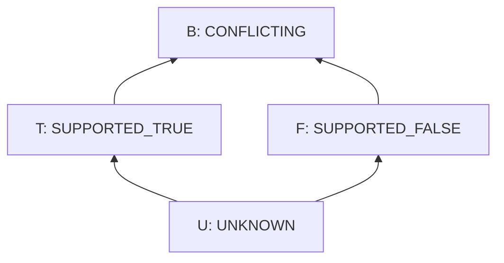
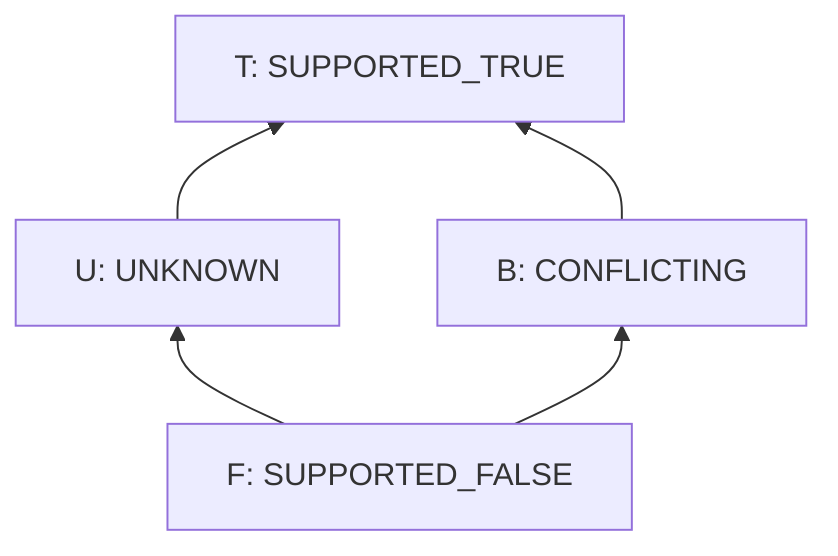

# RFC-0006: Four-Valued Information Logic and Constraint Core

- Status: Draft
- Version: 0.1
- Type: Foundational semantic profile
- Depends on: RFC-0001, RFC-0002, RFC-0003, RFC-0004, RFC-0005
- Amends: RFC-0002 Sections 9.2 and 13; RFC-0005 Section 16
- Discussion target: Phase 1 logic and verifier foundation

## Abstract

RFC-0002 represents support for a proposition and its denial independently. It
also introduces four constraint results:

```text
UNKNOWN
SUPPORTED_TRUE
SUPPORTED_FALSE
CONFLICTING

SATISFIED
VIOLATED
UNKNOWN
CONFLICTING
```

That is the right semantic direction, but it is not yet a complete language or
conformance target. The current documents do not define both orders of the
four-valued structure, complete operator tables, designated values, exact
constraint-result mapping, evaluation failures, bounded quantification, or the
semantics of guarded requirements.

This RFC defines a small Constraint Core based on independent positive and
negative support. It is paraconsistent: one contradiction does not entail an
unrelated proposition. It is open-world: lack of support is not negative
support. It is typed, pure, bounded, deterministic, and evidence-preserving.

Each expression produces both an FDE information value for reasoning and a
strict structural status for hard-Constraint decisions. The second result
prevents conflict or missing support from being hidden by a compound support
value while still recognizing decisive witnesses and counterexamples.

The core deliberately does **not** introduce a general implication operator.
Material implication is unsafe as an execution requirement when a conflicting
antecedent can make an unresolved obligation appear satisfied. Instead, the
language defines an explicit guarded requirement with its own conservative
status table.

The governing rule is:

> Logical support, constraint validity, evaluation completion, and permission to
> execute are different judgments. No conversion between them is implicit.

## 1. Decision proposed

Adopt the following rules for the first executable Constraint Core profile:

1. An information value is exactly a pair `(t, f)` of positive and negative
   support bits.
2. The four values are `UNKNOWN`, `SUPPORTED_TRUE`, `SUPPORTED_FALSE`, and
   `CONFLICTING`.
3. Evidence accumulation uses the information order; logical `all` and `any`
   use the truth order.
4. Negation swaps the two support components.
5. Conjunction and disjunction use the Belnap-Dunn/FDE pair operations already
   sketched in RFC-0002.
6. Contradiction is local and MUST NOT cause explosion.
7. `SUPPORTED_TRUE` and `CONFLICTING` are truth-supported values for logical
   consequence, but logical support alone does not satisfy a hard Constraint.
8. Constraint evaluation computes both the FDE information value and a strict
   structural status that does not let unresolved or conflicting operands be
   masked by support-pair aggregation.
9. A malformed expression, missing vocabulary, unsupported operator, resource
   exhaustion, or incomplete Context Bundle is not an `UNKNOWN` truth value.
10. Constraint expressions are typed, pure, deterministic, side-effect free,
   and terminating under declared resource bounds.
11. The core expression operators are `atom`, `not`, `all`, and `any`.
12. Constraint forms are `require`, `forbid`, and `when ... require`.
13. The core has no general `implies` operator and no negation-as-failure.
14. Quantification is allowed only over immutable, finite, closed domains.
15. Every atom and domain provider belongs to an immutable typed vocabulary.
16. Every complete evaluation returns the relevant support value or values,
    provenance, missing support, conflicting support, assumptions, and
    diagnostic path.
17. Every hard Constraint is evaluated separately before operational policy
    combines its result.
18. The default effectful gate allows only complete, conflict-free satisfaction
    of every required Constraint, assurance obligation, and capability check.
19. The published conformance vector and executable checker are normative for
    this experimental profile.

## 2. Scope

This RFC defines:

- the four-valued carrier and names;
- the truth and information orders;
- negation, conjunction, disjunction, information meet, and information join;
- logical consequence and strict hard-Constraint acceptance;
- typed atomic predicate evaluation;
- the minimum Constraint Core abstract syntax;
- guarded requirement semantics;
- finite closed-domain quantification;
- evaluation completion and error separation;
- Constraint result records;
- default effectful gate mapping;
- deterministic diagnostics and provenance;
- conformance properties and test vectors.

This RFC does not define:

- a universal implication connective;
- unrestricted first-order quantification;
- recursion or user-defined recursive rules;
- negation as failure;
- probabilistic truth values;
- fuzzy membership;
- defeasible or default logic;
- a complete temporal logic;
- optimization objectives or soft preferences;
- general theorem proving;
- an authorization language replacing capability checks;
- host-language execution inside a Constraint;
- a final human surface syntax.

## 3. Normative language

The words MUST, MUST NOT, SHOULD, SHOULD NOT, and MAY describe requirements of
this proposal.

`U`, `T`, `F`, and `B` are mathematical abbreviations only. Canonical records
use the full names in Section 5.

## 4. Four judgments that must remain separate

The project currently uses similar words at several boundaries. This RFC makes
the result types explicit:

| Judgment | Result space | Question answered |
|---|---|---|
| Information | `U / T / F / B` | What eligible support exists for and against this proposition? |
| Constraint | `SATISFIED / VIOLATED / UNKNOWN / CONFLICTING` | What is the validity status of this Constraint for this subject? |
| Evaluation completion | `COMPLETE / INVALID / INDETERMINATE / INCOMPLETE_CONTEXT` | Did the declared evaluator finish correctly with enough context? |
| Execution gate | `ALLOW / DENY / DEFER` | May this Transition be attempted under this policy? |

None is a synonym for another.

In particular:

```text
UNKNOWN != false
CONFLICTING != arbitrary truth
INVALID != UNKNOWN
INDETERMINATE != CONFLICTING
SATISFIED != ALLOW
ALLOW != predicted success
```

## 5. Information carrier

For a normalized base proposition `p`, define:

```text
t(p) = 1 when at least one eligible support path supports p
f(p) = 1 when at least one eligible support path supports not-p
```

The value of `p` is:

```text
v(p) = (t(p), f(p)) in {0,1} x {0,1}
```

Canonical names are:

| Symbol | Pair | Canonical name | Meaning |
|---|---:|---|---|
| `U` | `(0,0)` | `UNKNOWN` | Neither side has eligible support |
| `T` | `(1,0)` | `SUPPORTED_TRUE` | Only the proposition has eligible support |
| `F` | `(0,1)` | `SUPPORTED_FALSE` | Only its denial has eligible support |
| `B` | `(1,1)` | `CONFLICTING` | Both sides have eligible support |

These are information states, not claims of objective metaphysical truth.

### 5.1 Evidence aggregation

Evidence for the same normalized proposition accumulates componentwise:

```text
(t1, f1) information_join (t2, f2)
  = (t1 or t2, f1 or f2)
```

Adding eligible evidence can move:

```text
U -> T
U -> F
T -> B
F -> B
```

It cannot silently remove an existing support bit. Evidence invalidation is a
new eligibility view with provenance, not mutation of history.

### 5.2 Atomic polarity normalization

Simple denial MUST be normalized to a base proposition plus polarity before
support is aggregated.

For example, support for:

```text
DENY(PaymentSucceeded(attempt_1))
```

sets the negative support component of the same base proposition whose positive
form is:

```text
ASSERT(PaymentSucceeded(attempt_1))
```

This prevents syntactic double negation from creating a different claim.

## 6. Two partial orders

The four values have two different orders. Conflating them is a semantic error.

### 6.1 Information order

`x <=k y` means that `y` contains at least the support information in `x`:

```text
(t1, f1) <=k (t2, f2)
  iff t1 <= t2 and f1 <= f2
```



This order governs evidence accumulation and common-information operations.

### 6.2 Truth order

`x <=t y` orders values from falsity support toward truth support:

```text
(t1, f1) <=t (t2, f2)
  iff t1 <= t2 and f2 <= f1
```



This order defines logical conjunction and disjunction.

Neither order is an assurance ranking. For example, `B` contains more support
information than `T`, but is not safer for an effectful gate.

## 7. Core operators

Let `x = (tx, fx)` and `y = (ty, fy)`.

### 7.1 Negation

```text
not (tx, fx) = (fx, tx)
```

| `x` | `not x` |
|---|---|
| `U` | `U` |
| `T` | `F` |
| `F` | `T` |
| `B` | `B` |

### 7.2 Conjunction

```text
x and y = (tx and ty, fx or fy)
```

| `and` | `U` | `T` | `F` | `B` |
|---|---|---|---|---|
| `U` | `U` | `U` | `F` | `F` |
| `T` | `U` | `T` | `F` | `B` |
| `F` | `F` | `F` | `F` | `F` |
| `B` | `F` | `B` | `F` | `B` |

### 7.3 Disjunction

```text
x or y = (tx or ty, fx and fy)
```

| `or` | `U` | `T` | `F` | `B` |
|---|---|---|---|---|
| `U` | `U` | `T` | `U` | `T` |
| `T` | `T` | `T` | `T` | `T` |
| `F` | `U` | `T` | `F` | `B` |
| `B` | `T` | `T` | `B` | `B` |

### 7.4 Variadic identities

The empty logical folds are:

```text
all([]) = T
any([]) = F

strict_all([]) = SATISFIED
strict_any([]) = VIOLATED
```

For non-empty lists:

```text
all([x1, ..., xn]) = x1 and ... and xn
any([x1, ..., xn]) = x1 or ... or xn
```

### 7.5 Information meet and join

These operations combine support views; they are not surface logical operators:

```text
x information_meet y = (tx and ty, fx and fy)
x information_join y = (tx or ty, fx or fy)
```

`information_join` is used to accumulate independent eligible evidence for one
normalized atom. `information_meet` identifies support common to two views.

They MUST NOT be substituted for logical `and` and `or`.

## 8. Algebraic requirements

Conforming implementations MUST satisfy:

- involutive negation;
- commutativity, associativity, and idempotence of `and` and `or`;
- absorption and distributivity for the truth lattice;
- both De Morgan laws;
- commutativity, associativity, idempotence, absorption, and distributivity for
  the information lattice;
- monotonicity of both lattice pairs under both declared orders;
- truth-order reversal and information-order preservation by negation.

The exact properties are executable in the conformance checker.

### 8.1 Designated values are not gate acceptance

For the minimum FDE consequence relation, the truth-supported designated values
are:

```text
D = {T, B}
```

Conceptually:

```text
Gamma entails_FDE p
```

only if every valuation that designates every premise also designates `p`.

Hard Constraint acceptance is stricter. An atomic `T` maps to `SATISFIED`, but
a compound expression is accepted only when its strict structural status is
`SATISFIED`:

```text
strictly_satisfied = {SATISFIED}
```

`B` can participate in paraconsistent reasoning without granting permission to
execute.

The distinction matters because FDE support aggregation can mask unresolved
operands:

```text
B or U = T
B and U = F
```

Those are correct information-support results. They are not sufficient
operational judgments. Strict evaluation reports `CONFLICTING` for both unless
another operand independently decides the Constraint, as defined in Section
12.

### 8.2 Non-explosion

The following entailment is invalid:

```text
p and not p entails_FDE q
```

Counterexample:

```text
p = B
q = F

p and not p = B  # designated
q = F            # not designated
```

Contradictory support for `p` therefore does not invent support for `q`.

### 8.3 No universal excluded middle

When `p = U`:

```text
p or not p = U
```

The open-world core does not convert missing support into certainty through a
classical tautology.

## 9. Typed atomic predicates

An atom is a normalized application:

```text
predicate_id(arguments, subject, scope)
```

Every predicate belongs to an immutable vocabulary that declares:

```text
predicate_id
argument and result types
allowed Constraint scopes
purity
determinism
totality conditions
required State and Evidence dependencies
evaluation method identity
resource-cost class
```

An atom evaluator returns positive and negative support records independently:

```text
AtomSupport
  value: U | T | F | B
  positive_support_ids
  negative_support_ids
  missing_support
  assumptions
  diagnostic_path
```

### 9.1 Exact resolved data

A pure predicate over exact immutable data may derive `T` or `F` directly from
the identified State snapshot, provided the derivation method and snapshot are
recorded.

Example:

```text
greater_or_equal(Money("10.00", "USD"), Money("0.00", "USD")) = T
```

Cross-currency comparison without an explicit conversion relation is invalid,
not unknown.

### 9.2 Evidence-backed claims

When an atom represents an external or epistemic claim, eligible evidence sets
determine its two support bits under the exact assurance and eligibility
profile.

The evaluator MUST NOT use:

- source count as truth;
- model confidence as a support bit without an explicit evidence policy;
- missing records as negative support;
- stale evidence outside its valid scope;
- a display name in place of semantic subject identity.

### 9.3 Absence, unresolved meaning, and failure

These cases are different:

| Case | Required handling |
|---|---|
| An optional value is explicitly absent | Evaluate an explicit option predicate such as `is_absent` |
| A well-formed claim lacks eligible support | `U` with missing-support reason |
| Both polarities have eligible support | `B` with both support sets |
| A required reference is unresolved in authoring IR | `INVALID` or non-executable authoring result |
| An operator or vocabulary is unsupported | `INVALID` |
| Evaluation exceeds a declared bound | `INDETERMINATE` |
| A mandatory Context dependency is unavailable | `INCOMPLETE_CONTEXT` |

An implementation MUST NOT turn the last four cases into `U` merely to keep
evaluation running.

## 10. Constraint Core abstract syntax

Constraint Core separates exact value terms from support-bearing propositions.
There is no implicit conversion between them.

```text
Term = Literal(type_id, canonical_value)
     | Ref(typed_semantic_path)
     | Call(function_id, [Term...])

Expr = Atom(predicate_id, [Term...])
     | Not(Expr)
     | All([Expr...])
     | Any([Expr...])
```

A `Term` evaluates to an exact typed value. An `Expr` evaluates to both an
information value and a strict status, plus support records.

### 10.1 Terms and value types

The minimum value-type system supports versioned exact forms for:

```text
Bool2
Int with declared bounds
Decimal with scale/profile
String with Unicode profile
Bytes
Timestamp and Duration with profile
semantic identity types
domain enums and records
Option<T>
List<T>, Set<T>, and Map<K,V> under declared collection semantics
```

`Bool2` is an ordinary exact domain value. It is not the four-valued information
carrier. A `Bool2` term becomes a proposition only through a typed predicate,
such as `equals(flag, true)`.

`Ref` resolution follows the Constraint scope and exact State/trace/graph
snapshot. Explicit domain absence is an `Option<T>` value. An unresolved
required reference is `INVALID`, not a falsey value.

A value function MUST be pure, deterministic, typed, and total over its declared
input domain. A mathematically partial operation must narrow its input type,
return an explicit `Option` or result type, or be guarded by a separately
verified precondition. It cannot signal falsehood by throwing a host exception.

### 10.2 Typing judgments

Let `Gamma` contain scope bindings, value types, function signatures, predicate
signatures, and vocabulary identities.

The core typing rules are:

```text
Gamma |- literal(type, value) : type

Gamma(path) = type
-------------------------
Gamma |- Ref(path) : type

function f : (A1, ..., An) -> B
Gamma |- e1 : A1 ... Gamma |- en : An
---------------------------------------
Gamma |- Call(f, [e1, ..., en]) : B

predicate p : (A1, ..., An) -> Proposition
Gamma |- e1 : A1 ... Gamma |- en : An
-------------------------------------------
Gamma |- Atom(p, [e1, ..., en]) : Proposition

Gamma |- p : Proposition
------------------------
Gamma |- Not(p) : Proposition

Gamma |- p1 : Proposition ... Gamma |- pn : Proposition
---------------------------------------------------------
Gamma |- All([p1, ..., pn]) : Proposition
Gamma |- Any([p1, ..., pn]) : Proposition
```

Constraint forms require proposition expressions:

```text
Gamma |- p : Proposition
------------------------
Gamma |- Require(p) : Constraint
Gamma |- Forbid(p) : Constraint

Gamma |- a : Proposition    Gamma |- r : Proposition
------------------------------------------------------
Gamma |- WhenRequire(a, r) : Constraint
```

No rule converts an arbitrary value, collection, missing reference, diagnostic,
or evaluation error into `Proposition`.

The first profile has three Constraint forms:

```text
Require(Expr)
Forbid(Expr)
WhenRequire(activation=Expr, requirement=Expr)
```

`Forbid(x)` is normalized to:

```text
Require(Not(x))
```

`WhenRequire` is not normalized to material implication. Its semantics are in
Section 11.

### 10.3 Provisional authoring projection

```text
constraint ShipmentRequiresAcceptedReceipt
  scope step
  subject ShipOrder
  when PaymentCaptured(order.payment_attempt)
  require ReceiptAccepted(order.payment_receipt)
```

### 10.4 Provisional canonical expression projection

```json
{
  "form": "when_require",
  "activation": {
    "op": "atom",
    "predicate": "payment.captured",
    "args": [{"ref": "step.input.order.payment_attempt"}]
  },
  "requirement": {
    "op": "atom",
    "predicate": "payment.receipt_accepted",
    "args": [{"ref": "step.input.order.payment_receipt"}]
  }
}
```

Field spelling remains provisional. Operator identities, types, and semantics
are identity-bearing.

### 10.5 No host-language escape

Constraint Core MUST NOT contain:

- arbitrary JavaScript, Python, shell, SQL, or template execution;
- network, file, clock, random, or ambient environment access;
- mutation;
- dynamic code loading;
- unbounded loops;
- implicit exceptions as truth values.

External observations arrive as identified State or Evidence through declared
dependencies.

## 11. Guarded requirements

A general implication operator is not part of Constraint Core v0.1.

Under the pair operations, material implication would normally be written:

```text
not activation or requirement
```

For `activation = B` and `requirement = U`, this expression evaluates to `T`:

```text
not B or U
= B or U
= T
```

That result is useful in some logical analyses but unsafe as the sole status of
an execution obligation. The positive activation support still creates a
requirement whose truth is unresolved.

Constraint Core therefore evaluates the activation and requirement to their
strict statuses, then applies this conservative result table:

| Activation \ Requirement | `UNKNOWN` | `SATISFIED` | `VIOLATED` | `CONFLICTING` |
|---|---|---|---|---|
| `UNKNOWN` | `UNKNOWN` | `SATISFIED` | `UNKNOWN` | `UNKNOWN` |
| `SATISFIED` | `UNKNOWN` | `SATISFIED` | `VIOLATED` | `CONFLICTING` |
| `VIOLATED` | `SATISFIED` | `SATISFIED` | `SATISFIED` | `SATISFIED` |
| `CONFLICTING` | `CONFLICTING` | `SATISFIED` | `CONFLICTING` | `CONFLICTING` |

The rules are:

1. a strictly satisfied requirement satisfies the Constraint regardless of
   activation;
2. a strictly violated activation makes the Constraint inapplicable and
   satisfied;
3. a strictly satisfied activation delegates to the requirement status;
4. an unknown activation leaves every non-satisfied requirement unknown;
5. a conflicting activation leaves every non-satisfied requirement
   conflicting.

Nested activation and requirement diagnostics MUST remain visible even when the
outer result is `SATISFIED`.

This operator expresses an operational guarded obligation. It MUST NOT be used
as a proof-theoretic implication relation.

## 12. Constraint result mapping

Every completed expression has two related outputs:

```text
information_value
  FDE support-pair result from Sections 5 through 7

strict_status
  operational validity result computed structurally
```

For an atom, strict status is:

| Atomic information value | Strict status |
|---|---|
| `T` | `SATISFIED` |
| `F` | `VIOLATED` |
| `U` | `UNKNOWN` |
| `B` | `CONFLICTING` |

For `Not(expr)`, strict status swaps `SATISFIED` and `VIOLATED` while preserving
`UNKNOWN` and `CONFLICTING`.

For compound expressions, strict `All` is:

| `all` | `UNKNOWN` | `SATISFIED` | `VIOLATED` | `CONFLICTING` |
|---|---|---|---|---|
| `UNKNOWN` | `UNKNOWN` | `UNKNOWN` | `VIOLATED` | `CONFLICTING` |
| `SATISFIED` | `UNKNOWN` | `SATISFIED` | `VIOLATED` | `CONFLICTING` |
| `VIOLATED` | `VIOLATED` | `VIOLATED` | `VIOLATED` | `VIOLATED` |
| `CONFLICTING` | `CONFLICTING` | `CONFLICTING` | `VIOLATED` | `CONFLICTING` |

Strict `Any` is:

| `any` | `UNKNOWN` | `SATISFIED` | `VIOLATED` | `CONFLICTING` |
|---|---|---|---|---|
| `UNKNOWN` | `UNKNOWN` | `SATISFIED` | `UNKNOWN` | `CONFLICTING` |
| `SATISFIED` | `SATISFIED` | `SATISFIED` | `SATISFIED` | `SATISFIED` |
| `VIOLATED` | `UNKNOWN` | `SATISFIED` | `VIOLATED` | `CONFLICTING` |
| `CONFLICTING` | `CONFLICTING` | `SATISFIED` | `CONFLICTING` | `CONFLICTING` |

Strict negation is involutive. Strict `All` and `Any` are commutative,
associative, and idempotent, and they satisfy both De Morgan laws. This RFC does
not claim that the strict-status operations form the same bilattice or satisfy
every absorption and distributivity law of the information operators.

These tables preserve decisive witnesses:

```text
SATISFIED any x = SATISFIED
VIOLATED all x = VIOLATED
```

Otherwise, conflict outranks unknown, and unknown outranks the non-decisive
identity. Therefore:

```text
strict(B or U) = CONFLICTING
strict(B and U) = CONFLICTING
strict(T or U) = SATISFIED
strict(F and U) = VIOLATED
```

This is not a replacement logic. The FDE value remains available for logical
reasoning and provenance; strict status prevents an execution gate from
mistaking one-sided support aggregation for conflict-free validity.

`Require(expr)` returns the expression's strict status. `Forbid(expr)` first
applies four-valued and strict negation. `WhenRequire` uses Section 11 directly.

Every result contains:

```text
ConstraintResult
  constraint_id
  constraint_content_id
  subject_id
  scope
  vocabulary_ids
  evaluation_profile_id
  completion
  information_value and strict_status for Require or normalized Forbid
  activation and requirement information values and strict statuses for WhenRequire
  constraint_status when completion = COMPLETE
  positive_support_ids
  negative_support_ids
  missing_support
  conflicting_support
  assumptions
  dependency_content_ids
  diagnostic_path
  evaluator_id
```

`SATISFIED` is a scoped result for an exact subject, snapshot, vocabulary, and
profile. It is not a timeless flag on the Constraint.

## 13. Evaluation completion

The evaluator returns one of:

```text
COMPLETE
INVALID
INDETERMINATE
INCOMPLETE_CONTEXT
```

### 13.1 COMPLETE

Parsing, name resolution, typing, dependency loading, and bounded evaluation all
succeeded. The result contains the information value or values required by its
Constraint form and one Constraint status.

### 13.2 INVALID

The expression is malformed or semantically unsupported. Examples include:

- type mismatch;
- unbound required reference;
- duplicate semantic identity;
- unknown operator;
- unavailable required vocabulary;
- invalid scope access;
- non-total predicate outside its declared domain.

Invalid Constraints cannot be executed or treated as unknown claims.

### 13.3 INDETERMINATE

The evaluator could not finish under its declared resource or method profile.
Timeout, solver `unknown`, unsupported proof fragment, and resource exhaustion
belong here with precise reasons.

### 13.4 INCOMPLETE_CONTEXT

A mandatory semantic dependency lies outside the supplied Context Bundle or
could not be resolved. The result names the cut dependency and resolution
action.

An effectful gate MUST NOT return `ALLOW` for any non-`COMPLETE` evaluation.

## 14. Constraint scopes and environments

Every Constraint declares one scope and receives only that scope's bindings:

| Scope | Minimum environment |
|---|---|
| `state` | Identified immutable State snapshot |
| `step` | Pre-State, Transition contract, inputs, selected outcome, post-State, observations |
| `trace` | Identified finite trace view, event order, completion marker, closure metadata |
| `subgraph` | Block manifest, typed internal topology, boundary contract |
| `program` | Program manifest, Block bindings, cross-Block topology, exports |

Access outside the declared environment requires an explicit dependency and
vocabulary operation.

### 14.1 Finite traces versus liveness

Constraint Core can evaluate safety properties over a finite, identified trace
view, such as:

```text
count(capture_committed for intent_id) <= 1
```

It cannot prove an unbounded liveness property such as "every request will
eventually finish" without a temporal-logic and fairness profile.

Temporal operators are deferred to a separate extension rather than being
approximated by hidden runtime loops.

## 15. Bounded quantification

The optional finite-quantifier extension is:

```text
ForAll(binding, closed_domain, body)
Exists(binding, closed_domain, body)
```

A quantified domain MUST be:

- immutable for the evaluation;
- finite;
- deterministically ordered for diagnostics;
- typed;
- content-identified;
- declared `COMPLETE` for the exact subject and scope.

If domain closure cannot be established, evaluation returns
`INCOMPLETE_CONTEXT`; it does not assume a closed world.

Semantics for a complete domain are:

```text
ForAll(x in [a1, ..., an], body)
  = all([body[x=a1], ..., body[x=an]])

Exists(x in [a1, ..., an], body)
  = any([body[x=a1], ..., body[x=an]])
```

Both the FDE information fold and the corresponding strict-status fold are
computed.

Therefore:

```text
ForAll(x in [], body) = T
Exists(x in [], body) = F
```

Implementations MUST declare limits on domain cardinality, expression depth,
and total atom evaluations. Exceeding a limit returns `INDETERMINATE`.

## 16. Evaluation strategy

The denotational result is independent of source order.

An implementation MAY short-circuit computation only when it preserves:

- the exact final value;
- required support provenance;
- required conflict and missing-support diagnostics;
- declared cost accounting;
- deterministic output ordering.

Because evaluation is pure and bounded, the reference profile evaluates all
operands. A production optimizer may use cached subexpressions by semantic
content identity.

Common subexpression elimination MUST NOT merge atoms evaluated under different
subjects, scopes, evidence policies, times, or vocabulary versions.

## 17. Default effectful gate

The default operational mapping for an effectful Transition is:

| Constraint status | Default gate contribution |
|---|---|
| `SATISFIED` | Continue evaluating other requirements |
| `VIOLATED` | `DENY` |
| `UNKNOWN` | `DEFER` |
| `CONFLICTING` | `DEFER` |

Completion mapping is:

| Completion | Default gate contribution |
|---|---|
| `COMPLETE` | Use Constraint status |
| `INVALID` | `DENY` |
| `INDETERMINATE` | `DEFER` |
| `INCOMPLETE_CONTEXT` | `DEFER` |

An effectful gate returns `ALLOW` only when:

1. every required hard Constraint is individually `SATISFIED`;
2. every evaluation is `COMPLETE`;
3. the exact assurance profile accepts the Evidence used;
4. required capabilities are present and valid;
5. the Context Bundle is sufficient for the execution-gate profile;
6. no independent deny policy applies.

Multiple hard Constraints MUST NOT be reduced only to one `all(...)` value,
because aggregation can hide which individual Constraint was conflicting or
unknown.

The default precedence is:

```text
known prohibition or invalid policy -> DENY
otherwise unresolved safety judgment -> DEFER
otherwise all required judgments satisfied -> ALLOW
```

A pure reasoning profile MAY continue through `UNKNOWN` or `CONFLICTING`, but it
must preserve those statuses and MUST NOT relabel them `SATISFIED`.

## 18. Examples

### 18.1 Payment receipt gate

```text
constraint ShipmentRequiresAcceptedReceipt
  when PaymentCaptured(attempt)
  require ReceiptAccepted(receipt)
```

The following rows use atomic information values for Capture and Receipt:

| Capture | Receipt | Result | Effectful gate |
|---|---|---|---|
| `T` | `T` | `SATISFIED` | may continue |
| `T` | `U` | `UNKNOWN` | `DEFER` |
| `T` | `F` | `VIOLATED` | `DENY` |
| `T` | `B` | `CONFLICTING` | `DEFER` |
| `B` | `U` | `CONFLICTING` | `DEFER` |
| `B` | `T` | `SATISFIED` | may continue |
| `F` | any | `SATISFIED` | inapplicable |

`B/T` is satisfied because the receipt requirement holds whether or not the
conflicting capture claim is ultimately resolved. The capture conflict remains
in diagnostics and may still block another policy that requires a consistent
capture observation.

### 18.2 At-most-one capture

For a closed trace snapshot:

```text
require less_or_equal(
  count(trace.events, CaptureCommitted(intent_id)),
  1
)
```

If the trace view is not complete for the intent and observation boundary,
evaluation returns `INCOMPLETE_CONTEXT`. It does not infer that unobserved
captures do not exist.

### 18.3 AI publication gate

```text
require all([
  SourceScopeMatches(claim, source),
  CitationResolves(source),
  ClaimAcceptedUnder(claim, PublicationAssuranceV1)
])
```

`ClaimAcceptedUnder` evaluates both eligible support polarities under the named
assurance profile; it is not negation as failure. If eligible sources support
and refute the claim, the final relevant atom is `B`; the hard Constraint is
`CONFLICTING`, and publication defers. An AI cannot remove the refuting source
to manufacture `T` without changing the Evidence view and leaving an auditable
provenance event.

## 19. Canonical representation requirements

Every identity-bearing Constraint records:

```text
constraint form and scope
normalized typed expression AST
operator vocabulary identities
subject and binding schema
evaluation profile
domain closure requirements
semantic extensions
```

Display syntax, comments, localized labels, and source positions remain outside
Constraint semantic identity.

Normalization MUST:

- resolve operator identities;
- type every expression;
- normalize simple atomic polarity;
- flatten nested `all` and `any` when profile-equivalent;
- sort operands only when the exact form declares them an unordered semantic
  set;
- preserve ordered diagnostic or priority lists;
- reject unsupported semantic extensions;
- remain idempotent.

Normalization MUST NOT use classical rewrites that are invalid in FDE or unsafe
for guarded requirements.

In particular, a normalizer MUST NOT rewrite:

```text
p or not p -> T
p and not p -> F
WhenRequire(p, q) -> not p or q
```

## 20. Amendments to previous RFCs

### 20.1 RFC-0002 connective behavior

RFC-0002 Section 9.2's pair equations are retained and completed by Sections 6
through 8 of this RFC.

### 20.2 RFC-0002 guarded invariant

The prose definition of `P => Q` as a guarded invariant is superseded for
execution Constraints by `WhenRequire(P, Q)` in Section 11.

This RFC does not claim that no useful four-valued implication exists. It
states that implication choice is profile-specific and must not be silently
identified with an operational gate.

### 20.3 RFC-0002 Constraint result

The four completed Constraint statuses remain unchanged. This RFC adds a
separate evaluation-completion dimension so malformed or unfinished evaluation
does not masquerade as incomplete evidence.

### 20.4 RFC-0005 Constraint taxonomy

RFC-0005 Section 16 remains normative. Each Constraint form now additionally
declares its logic and vocabulary profile. Temporal, assurance, authorization,
and planning profiles may extend the expression vocabulary without changing the
four-valued carrier.

## 21. Verification and conformance vectors

The companion files are:

- [`four-valued-constraint-vectors.json`](./four-valued-constraint-vectors.json)
  — exact value encodings, FDE operator matrices, both orders, strict-status
  matrices, guarded requirements, and gate mapping;
- [`verify-four-valued-constraints.mjs`](./verify-four-valued-constraints.mjs)
  — dependency-free executable checker for the vectors and algebraic laws.

The JSON vector is normative for v0.1. The JavaScript checker is an executable
reference, not the only conforming implementation.

Implementations in other languages MUST produce the same named results for all
vector cases.

## 22. Security considerations

### 22.1 Unknown-as-false downgrade

Negation as failure or a host-language falsey conversion can transform missing
support into permission. Both are prohibited.

### 22.2 Conflict laundering

Selecting only positive evidence can turn `B` into `T`. Evidence eligibility
views, exclusions, and conflict resolution require immutable policy identity
and provenance.

### 22.3 Implication laundering

Rewriting `WhenRequire(p, q)` as `not p or q` can mark an unresolved obligation
satisfied under conflicting activation. The forms have distinct semantic
identities.

### 22.4 Error laundering

Type errors, unsupported vocabularies, solver timeouts, and missing Context
dependencies cannot be converted to `U` and passed to a permissive policy.

### 22.5 Host escape

Arbitrary host-language calls would bypass purity, capability, resource, and
identity boundaries. Predicate implementations must be registered, versioned,
typed, and sandboxed by the embedding runtime.

### 22.6 Resource exhaustion

Nested expressions and quantified domains have declared bounds. Exceeding a
bound yields `INDETERMINATE`, never partial `SATISFIED`.

### 22.7 Stale scope

A valid result for one State, trace, evidence view, time, or Program content
identity cannot authorize another without a declared equivalence proof.

## 23. Minimum conformance

An implementation claiming experimental RFC-0006 conformance MUST:

1. represent every information value as two independent support bits;
2. preserve the four canonical names and pair encodings;
3. implement both partial orders;
4. implement the exact `not`, `and`, and `or` tables;
5. implement information meet and join without exposing them as logical
   aliases;
6. keep contradiction non-explosive;
7. distinguish logical designated values from strict hard-Constraint
   satisfaction;
8. compute both information value and strict structural status for compound
   expressions;
9. implement typed immutable vocabulary identities;
10. reject unknown operators and type mismatches as `INVALID`;
11. distinguish all four evaluation-completion results;
12. implement `Require`, `Forbid`, and the exact `WhenRequire` table;
13. omit general implication and negation-as-failure from the core profile;
14. quantify only over immutable finite closed domains;
15. enforce expression and evaluation resource bounds;
16. retain positive, negative, missing, and conflicting support diagnostics;
17. bind every result to exact subject, scope, evaluator, vocabulary, and
    dependency identities;
18. map effectful gates according to Section 17 unless a stricter named policy
    applies;
19. never `ALLOW` a non-complete evaluation;
20. pass every companion conformance vector;
21. publish cross-language differential results before declaring a stable
    public constraint format.

## 24. Falsification criteria

This profile is weakened or falsified if:

1. independent positive and negative support cannot express the required
   production cases;
2. the exact tables differ across conforming languages;
3. a contradiction can derive an unrelated proposition;
4. a normalizer needs classical rewrites that change four-valued results;
5. the guarded requirement table permits a known unresolved effectful
   obligation to pass;
6. valid common Constraints require arbitrary recursion or host-language escape;
7. finite closed-domain quantification cannot express useful state, step, and
   bounded-trace invariants;
8. provenance-preserving evaluation is too costly for execution gates;
9. separating completion from information causes more ambiguity than it
   removes;
10. a smaller formally specified language provides equal safety,
    explainability, and AI usability.

## 25. Related foundations

The independent-support carrier and paraconsistent interpretation follow the
direction established by:

- Nuel D. Belnap,
  [A Useful Four-Valued Logic](https://doi.org/10.1007/978-94-010-1161-7_2),
  1977.
- J. Michael Dunn,
  [Intuitive Semantics for First-Degree Entailments and “Coupled Trees”](https://doi.org/10.1007/BF00373152),
  1976.

The two-order bilattice perspective is informed by:

- Matthew L. Ginsberg,
  [Multivalued Logics: A Uniform Approach to Reasoning in Artificial Intelligence](https://doi.org/10.1111/j.1467-8640.1988.tb00280.x),
  1988.

Language-engineering constraints are informed by, but do not copy:

- the [Common Expression Language specification](https://github.com/cel-expr/cel-spec),
  which emphasizes a small, pure, terminating embedded expression language;
- the [SMT-LIB 2.7 standard](https://smt-lib.org/papers/smt-lib-reference-v2.7-r2025-04-09.pdf),
  which separates typed logical language, theories, fragments, and solver
  interface;
- [Cedar](https://doi.org/10.1145/3649835), whose formal semantics,
  machine-checked metatheory, validation, and analyzable fragment demonstrate a
  useful standard for security-relevant DSLs;
- Leslie Lamport's
  [Temporal Logic of Actions](https://doi.org/10.1145/177492.177726), which is a
  candidate foundation for a later trace/liveness profile rather than an
  operator subset to imitate casually.

AI Native Core does not claim novelty for FDE or bilattices. Its contribution,
if validated, is their integration with typed semantic Blocks, Evidence
eligibility, explicit effects and capabilities, guarded execution, deterministic
identity, and bounded Context Bundles.

## 26. Open questions

1. Should the stable profile expose a proof-theoretic implication operator, and
   if so, which entailment properties are required?
2. Should guarded activation conflict always produce `CONFLICTING`, or may a
   named risk profile collapse some cases to `UNKNOWN`?
3. Which atomic theory fragments should be built in: exact integers, decimals,
   time intervals, strings, finite sets, or typed graph relations?
4. Should arithmetic atoms lower to an SMT solver, a verified native evaluator,
   or both with differential testing?
5. What proof object or evidence record should accompany solver-derived support?
6. How should incomplete but witness-bearing domains support safe one-sided
   `Exists` or `ForAll` conclusions?
7. Which temporal profile best preserves partial and conflicting observations?
8. Can the algebra and evaluator be mechanized in Lean, Rocq, or Isabelle with
   acceptable maintenance cost?
9. Which compact surface syntax produces the fewest AI semantic errors?
10. How should semantic patches address commutative `all` and `any` operands?

## 27. Current conclusion

The four values are not four shades of Boolean confidence. They record two
independent facts: support for a proposition and support for its denial.

The Constraint Core remains deliberately small:

```text
atom
not
all
any

require
forbid
when ... require
```

Everything else must arrive through a typed, versioned profile with exact
semantics.

> Preserve both sides of evidence. Reject invalid meaning. Defer unresolved
> action. Never let contradiction invent permission.
